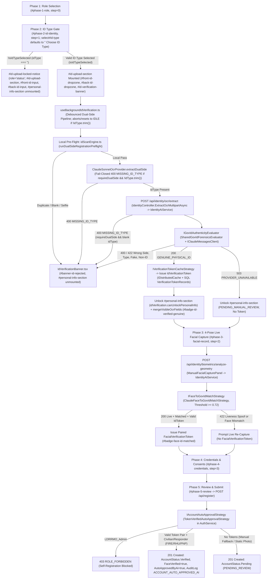

# ID OCR CURRENT STATE -- ARCHITECTURE, UNIFIED 5-PHASE REGISTRATION & AUTO-APPROVAL TRACE

## 1. End-to-End Architecture Flow (`Unified 5-Phase Registration, Background Forensics, Standby Tokens & AI Auto-Approval`)

---

## 2. Unified 5-Phase Registration & DOM Contract (`RegisterPage.tsx`)

| Phase Step (`step`) | Stepper Label | Container Section ID | Primary Next / Submit ID | Key Child Selectors & Behavior |
| :---: | :--- | :--- | :--- | :--- |
| `0` | `01 Role` | `#phase-1-role` | `#btn-phase1-next` | Role selection (`Civilian`, `Responder` with `FIRE`/`RHU`/`PNP`; `LDRRMO_Admin` never offered). Role/unit changes and `?unit=*` query params NEVER pre-fill `idType`. |
| `1` | `02 ID & Info` | `#phase-2-id-identity` | `#btn-phase2-next` | `select#id-type` starts strictly at `""` (`<option value="">Choose ID Type</option>` selectable first child) with `#id-type-error` (`role="alert"`). While `!isIdTypeSelected`, `#id-upload-locked-notice` (`role="status"`) is rendered and `#id-upload-section`, `#front-id-dropzone`, `#front-id-input`, `#back-id-dropzone`, `#back-id-input`, `#btn-clear-both-ids`, `#id-verification-banner`, and `#personal-info-section` are strictly unmounted (`count === 0`). Once a valid ID type is chosen, `#id-upload-section` mounts (`#front-id-input`, `#back-id-input`, `#front-id-preview`, `#back-id-preview`, `#btn-clear-both-ids`, `#id-verification-banner`). `#personal-info-section` unlocks ONLY when `isIdTypeSelected && idVerification.canUnlockPersonalInfo === true` (after Front & Back ID upload + background verification/OCR), then renders `#license-number`, `#first-name`, `#middle-name`, `#last-name`, `#suffix`, `#sex`, `#dob`, `#age`, `#phone-number`, `#province`, `#city`, `#barangay`, `#street-purok`, `#weight`, `#height`, `#agency-unit`, `#employee-id`, `#rank-title`. |
| `2` | `03 Facial` | `#phase-3-facial-record` | `#btn-phase3-next` | `#manual-facial-capture-panel`, `#btn-request-camera`, `#btn-synthetic-test-mode`, `#btn-upload-facial-photo`, `#facial-file-upload-input`, `#btn-lock-next-pose`, `#btn-confirm-facial-capture`, `#facial-consent-checkbox`, `#badge-facial-confirmed`, `#badge-face-id-matched`. |
| `3` | `04 Auth` | `#phase-4-credentials` | `#btn-phase4-next` | `#display-name`, `#email`, `#password`, `#confirm`, `#pw-toggle`, `#consent-1`, `#consent-2`, `#btn-accept-both-consents`. |
| `4` | `05 Review` | `#phase-5-review` | `#submit` | `#review-role`, `#review-display-name`, `#review-email`, `#review-id-type`, `#review-fullname`, `#review-phone`, `#review-address`, `#review-verification-mode`, `#review-edit-phase1` (`step=0`), `#review-edit-phase2` (`step=1`), `#review-edit-phase3` (`step=2`), `#review-edit-phase4` (`step=3`). |

### `Choose ID Type` Gate & Reset Transition Semantics (`RegisterPage.tsx`)
1. **Initial Load / `?unit=*` Query Params**: `idType` initializes as `""` (`Choose ID Type`); `?unit=rhu|pnp|fire|bfp|security` sets only role/unit/rank metadata and never sets `idType`.
2. **Valid Type Switch (e.g., `'drivers' -> 'passport'`)**: Preserves `idFrontShot`, `idBackShot`, `idFrontMeta`, and `idBackMeta` while clearing stale standby tokens (`clearStandbyToken()`, `clearStandbyRegistrationTokens()`, `resetStaleFacialTokenOnIdMutation()`) and re-running `useBackgroundIdVerification`.
3. **Reset to `""` or `Civilian` Switch with `responderOnly` ID (`'fire'`, `'police'`, `'rhu'`)**: Clears `idFrontShot`, `idBackShot`, metadata, DOM `<input>.value` on both file refs, and `resqtrack_standby_*` tokens, unmounting `#id-upload-section` and `#personal-info-section` behind `#id-upload-locked-notice`.
4. **Defensive Upload & Drop Guards**: `handleFileUpload` and `handleDrop` reject uploads when `!isIdTypeSelected`, reset the file input value to `""`, and emit `#id-type-error`. `#btn-clear-both-ids` preserves `idType` while clearing shots, DOM input values, and standby tokens.

### Decommissioned UI Artifacts (Removed)
- **Removed Component**: `Frontend/src/LANDING_PAGE/Features/Pages/RegisterPage/ClaudeIdOcrAutoFillPanel.tsx`
- **Removed Selectors**: `#claude-id-ocr-panel`, `#btn-claude-ocr-extract`, all 14 `#ocr-field-*` inputs, `#btn-confirm-ocr-autofill`, `#badge-ocr-autofill-confirmed`, `#phase-2-id-upload`, `#phase-3-personal-info`, `#phase-4-facial-record`, `#phase-5-credentials`, `#phase-6-review`, `#btn-phase5-next`, `#review-edit-phase5`.

---

## 3. File-by-File Inventory

### Frontend (`Project system ENGINE/Frontend/src/`)

| Layer | File Path | Status | Responsibility & Locked Contract |
| :--- | :--- | :--- | :--- |
| **Background ID Hook** | `Frontend/src/Hooks/useBackgroundIdVerification.ts` | Active (Updated) | Headless orchestration hook triggering only when `idType.trim()`, `frontImageDataUrl`, and `backImageDataUrl` are all non-empty (zero `'philsys'` fallback). Emits/recognizes `MISSING_ID_TYPE`, uses `AbortController` to cancel stale flights, resets to `IDLE` (`canUnlockPersonalInfo: false`) when `idType` or either image is empty, runs `runDualSideRegistrationPreflight`, calls `ClaudeSonnetOcrProvider.extractDualSide`, and manages `VERIFIED_GENUINE`, `PENDING_MANUAL_REVIEW`, and `REJECTED_LOCAL` / `REJECTED_AI`. |
| **Verification Banner** | `Frontend/src/LANDING_PAGE/Features/Pages/RegisterPage/IdVerificationBanner.tsx` | Active | Compact Deep Burgundy + Lucide status/rejection banner (`#id-verification-banner`, `#badge-id-verified-genuine`, `#badge-id-pending-manual`, `#banner-id-rejected`, `#btn-retry-id-verify`) mounted inside `#id-upload-section` only after `isIdTypeSelected === true`. |
| **Registration Wizard** | `Frontend/src/LANDING_PAGE/Features/Pages/RegisterPage/RegisterPage.tsx` | Active (Updated) | Unified 5-phase registration wizard (`step=0..4`, `?step=` clamped to `[0, 4]`). Initializes `idType` strictly as `''` (`<option value="">Choose ID Type</option>`), enforces zero pre-fill on `?unit=*`/role/agency handlers, renders `#id-upload-locked-notice` while `!isIdTypeSelected`, mounts `#id-upload-section` (`#front-id-dropzone`, `#back-id-dropzone`, `<IdVerificationBanner />`) only after valid ID type selection, adds defensive guards in `handleFileUpload`/`handleDrop`, and mounts `#personal-info-section` only when `isIdTypeSelected && idVerification.canUnlockPersonalInfo`. |
| **Legacy OCR Panel** | `Frontend/src/LANDING_PAGE/Features/Pages/RegisterPage/ClaudeIdOcrAutoFillPanel.tsx` | Decommissioned / Deleted | Intermediate manual OCR panel removed cleanly in favor of automatic background verification via `useBackgroundIdVerification.ts` + `IdVerificationBanner.tsx`. |
| **Facial Capture UI** | `Frontend/src/LANDING_PAGE/Features/Pages/RegisterPage/ManualFacialCapturePanel.tsx` | Active (Updated) | Executes 4-pose live camera capture (`CENTER`, `RIGHT`, `LEFT`, `BLINK`) and invokes `claudeFacialBiometricStrategy` with `frontIdImageBase64` and `idVerificationToken`. Renders `#badge-face-id-matched` when `isFaceMatchedToId && facialVerificationToken`; prompts retry on `FACE_TO_ID_MISMATCH` / `LIVENESS_SPOOF_REJECTED` and degrades gracefully to `PENDING_MANUAL_REVIEW` on `503 PROVIDER_UNAVAILABLE`. |
| **Interactive ROI Overlay** | `Frontend/src/LANDING_PAGE/Features/Pages/RegisterPage/TextExtractorOverlay.tsx` | Active | Allows targeted bounding-box ROI OCR (`extractCustomRegionText`) over uploaded ID previews. |
| **Wizard Styles** | `Frontend/src/LayoutStyles/register.css` | Active (Updated) | Configures 5-column `.steps` grid (`repeat(5, 1fr)`), `.id-verification-banner`, and Deep Burgundy `.id-upload-locked-notice` styling. |
| **Auth API Client** | `Frontend/src/Endpoints/authEndpoints.ts` | Active (Updated) | Extends `RegisterPayload`, `RegisterResponse`, and `UserSession` with typed `idVerificationToken?: string`, `facialVerificationToken?: string`, `autoApprovedByAi?: boolean`, and `autoApprovalReason?: string`. |
| **Facial Biometric Client** | `Frontend/src/Libs/Biometrics/claudeFacialBiometricStrategy.ts` | Active (Updated) | Updates `ClaudeFacialGeometryPayload` and `ClaudeFacialGeometryAnalysisResult` to transmit `frontIdImageBase64` and `idVerificationToken` and parse `isLiveHuman`, `isFaceMatchedToId`, `faceToIdSimilarity`, `facialVerificationToken`, `isAutoApproveEligible`, `requiresPendingManualReview`, `errorCode`, and `errorMessage`. |
| **Local Pre-Flight Gate** | `Frontend/src/Libs/Vision/idScanner/idScanEngine.ts` | Active (Updated) | Preserves `scanUploadedIdImage` and adds pure `runDualSideRegistrationPreflight(frontImageData, backImageData, selectedCategory)` to block duplicate Front/Back byte digests (`DUPLICATE_FRONT_BACK_IMAGE`), blank/unreadable uploads (`UNREADABLE_OR_BLANK_IMAGE`), and anti-selfie/non-ID captures (`NON_ID_DOCUMENT`) before calling Backend AI. |
| **OCR Field Utilities** | `Frontend/src/Libs/Vision/idScanner/ai/ocrFieldUtils.ts` | Active (Updated) | Extends `OcrErrorCode` with `MISSING_ID_TYPE`, `MISSING_BACK_IMAGE`, `WRONG_ID_SIDE_FRONT_EXPECTED`, `WRONG_ID_SIDE_BACK_EXPECTED`, `WRONG_GOVERNMENT_ID_TYPE`, `DUPLICATE_FRONT_BACK_IMAGE`, `FAKE_OR_AI_GENERATED_ID`, `NON_ID_DOCUMENT`; provides `VisibleOcrFields`, `sanitizeVisibleOcrFields`, and non-destructive `mergeVisibleOcrFields`. |
| **AI OCR Provider** | `Frontend/src/Libs/Vision/idScanner/ai/ClaudeSonnetOcrProvider.ts` | Active (Updated) | Adds `MISSING_ID_TYPE` to `VALID_OCR_ERROR_CODES` & `SEMANTIC_REJECTION_ERROR_CODES`, removes `'philsys'` fallback in `buildMultipartFormData` & `extract`, fails closed before `fetch` in `extractDualSide` when `requireDualSide && !idType.trim()`, preserves all HTTP 400/422 forensics rejection codes without collapsing them into `UNREADABLE_OR_BLANK_IMAGE`, parses `idVerificationToken` and forensics metadata, and sets `requiresPendingManualReview: true` on HTTP `503` / `PROVIDER_UNAVAILABLE`. |
| **Local Vision Pipeline** | `Frontend/src/Libs/Vision/idScanner/` (`idRecognitionPipeline.ts`, `idSpecs.ts`, `idTemplateRegistry.ts`, `idScanWorker.ts`, `textExtractor.ts`, `dynamicAnchorParser.ts`, `onDeviceWasmOcr.ts`, `validators.ts`, `qualityGates.ts`, `cardPresenceGate.ts`) | Active (Preserved) | Preserved deterministic template-aware local CV/OCR modules. `idRecognitionPipeline.ts` retains `NEEDS_USER_REVIEW` contract for lower-level unit benchmarks while registration gating executes in `runDualSideRegistrationPreflight` and `useBackgroundIdVerification.ts`. |

### Backend (`Project system ENGINE/Backend/`)

| Layer | File Path | Status | Responsibility & Locked Contract |
| :--- | :--- | :--- | :--- |
| **Shared Forensics & Face-ID Contracts** | `Backend/Features/Services/Verification/GovIdForensicsContracts.cs` | Active (New) | Defines `IGovIdAuthenticityEvaluator`, `SharedGovIdForensicsEvaluator`, `IFaceToGovIdMatchStrategy`, `ClaudeFaceToGovIdMatchStrategy`, `GovIdAuthenticityInput`, `GovIdForensicsResult`, `FaceToGovIdMatchInput`, and `FaceToGovIdMatchResult`. Pre-checks `MISSING_FRONT_IMAGE` and byte-identical `DUPLICATE_FRONT_BACK_IMAGE` before invoking `IClaudeMessagesClient` (`claude-sonnet-4-6` -> `claude-sonnet-5-5`); enforces `FaceToIdMatchThreshold` (`0.72`). |
| **Token Cache & Auto-Approval Contracts** | `Backend/Features/Services/Verification/VerificationTokenContracts.cs` | Active (New) | Defines `VerificationTokenOptions`, `TokenIssueResult`, `TokenValidationResult`, `AutoApprovalDecision`, `IVerificationTokenCacheStrategy`, `HmacVerificationTokenCacheStrategy`, `IAccountAutoApprovalStrategy`, and `TokenVerifiedAutoApprovalStrategy`. Dual-persists `{base64UrlPayload}.{base64UrlHmacSha256}` tokens in `IDistributedCache` and SQL Server 2022 `[VerificationTokenRecords]` with constant-time `CryptographicOperations.FixedTimeEquals` validation and atomic single-use pair consumption. |
| **Identity AI Service** | `Backend/Features/Services/Implementations/IdentityAiService.cs` | Active (Updated) | Delegates ID authenticity/OCR to `IGovIdAuthenticityEvaluator` and Face-to-ID analysis to `IFaceToGovIdMatchStrategy`, minting `IdVerificationToken` on `ExtractIdOcrAsync` and paired `FacialVerificationToken` on `AnalyzeFacialGeometryAsync` via `IVerificationTokenCacheStrategy`. Preserves partial-payload compatibility when `backBytes == null` and minimal mock JSON omits optional forensics keys. |
| **Standby Gov ID Strategy** | `Backend/Features/Services/Standby/ClaudeAutoApproveGovIdStrategy.cs` | Active (Updated) | Consumes shared `IGovIdAuthenticityEvaluator` rules (eliminating duplicated authenticity logic) and always fails closed (`Approved = false`) when Claude is offline or authenticity checks fail. |
| **Anthropic Client** | `Backend/Features/Services/Implementations/ClaudeMessagesClient.cs`, `Backend/Features/Services/Interfaces/IClaudeMessagesClient.cs` | Active | Shared Anthropic Messages API transport executing `claude-sonnet-4-6` primary with automatic `claude-sonnet-5-5` failover. |
| **Identity Controller & DTOs** | `Backend/Features/Api/Controllers/IdentityController.cs`, `Backend/Features/Api/DTOs/IdentityDtos.cs` | Active (Updated) | `ExtractOcrMultipartAsync` (`POST /api/identity/ocr/extract`) enforces `400 BadRequest` (`MISSING_ID_TYPE`) when `IsTruthyFlag(requireDualSide)` and `idType` is blank before invoking `aiService.ExtractIdOcrAsync`; `MapOcrActionResult` maps `MISSING_ID_TYPE` to `400 BadRequest`. Also maps `POST /api/identity/biometrics/analyze-geometry`, `POST /api/identity/ai-extract`, `POST /api/identity/analyze-document`, and `POST /api/identity-documents/analyze` to HTTP `200`, `400`, `422`, and `503` (`requiresPendingManualReview: true`). |
| **Auth Service, Controller & DTOs** | `Backend/Features/Services/Implementations/AuthService.cs`, `Backend/Features/Api/Controllers/AuthController.cs`, `Requests.cs`, `Responses.cs` | Active (Updated) | Extends `RegisterRequest` (`IdVerificationToken`, `FacialVerificationToken`) and `RegistrationResponse` (`AutoApprovedByAi`, `AutoApprovalReason`). Injects optional `IAccountAutoApprovalStrategy` and `IVerificationTokenCacheStrategy` into `AuthService` (preserving existing 4-arg and 6-arg constructors). Auto-approves verified `Civilian` and `Responder` (`FIRE`/`RHU`/`PNP`), hard-blocks `LDRRMO_Admin` (`403 ROLE_FORBIDDEN`), rejects invalid/replayed/partial tokens (`400`), keeps un-tokenized registrations as `AccountStatus.Pending`, and logs `AuditLog` `"ACCOUNT_AUTO_APPROVED_AI"`. |
| **SQL Server 2022 Models, DDL & Config** | `Backend/Features/Data/Models/VerificationTokenRecord.cs` (New), `User.cs`, `IdentityVerificationRecord.cs`, `AppDbContext.cs`, `Backend/Features/DBInfrastructure/DatabaseSeeder.cs`, `Backend/Program.cs`, `appsettings.json`, `appsettings.Development.json` | Active (Updated) | Adds `[VerificationTokenRecords]` entity/table + unique index `IX_VerificationTokenRecords_TokenId` + composite index `(ExpiresAtUtc, ConsumedAtUtc)`, adds token/auto-approval columns to `[Users]` (`IdVerificationTokenId`, `FacialVerificationTokenId`, `AutoApprovedByAi`, `AutoApprovedAtUtc`) and `[IdentityVerificationRecords]` (`VerificationTokenId`, `AuthenticityVerdict`, `FaceToIdMatchScore`, `AutoApproved`), adds `"VerificationTokens"` configuration section, and registers `IDistributedCache` + Wave 0.4 strategies in `Program.cs`. |

---

## 4. Verification Rules, Error Matrix & Standby Token Semantics

1. **Visible-Only Zero-Fabrication OCR Policy**:
   - Backend returns `null` and Frontend initializes `""` for any field not visibly printed on the uploaded ID image(s).
   - `mergeVisibleOcrFields` applies extracted non-empty values into `#personal-info-section` without overwriting user-entered values or injecting placeholder PII.
2. **Error Code & HTTP Status Matrix**:

| Error Code | Producer Layer | HTTP Status | Registration Phase & Token Outcome |
| :--- | :--- | :---: | :--- |
| `MISSING_ID_TYPE` | `ClaudeSonnetOcrProvider` (client fail-closed) & `IdentityController.ExtractOcrMultipartAsync` (`POST /api/identity/ocr/extract`) | `400` | Hard block before AI call when `requireDualSide` is true and `idType` is blank; `#id-upload-section` / `#personal-info-section` stay unmounted; no token issued. |
| `MISSING_FRONT_IMAGE` | Local Pre-Flight & `IdentityController` | `400` | Hard block; `#personal-info-section` remains unmounted; no token issued. |
| `MISSING_BACK_IMAGE` | Local Pre-Flight & `IdentityAiService` | `400` | Hard block; `#personal-info-section` remains unmounted; no token issued. |
| `DUPLICATE_FRONT_BACK_IMAGE` | `idScanEngine` & `SharedGovIdForensicsEvaluator` | `422` | Hard block; rejects identical Front/Back SHA-256 bytes before AI call; `#personal-info-section` hidden. |
| `WRONG_ID_SIDE_FRONT_EXPECTED` | `IdentityAiService` / `SharedGovIdForensicsEvaluator` | `422` | Hard block; Front slot received Back side; `#personal-info-section` hidden. |
| `WRONG_ID_SIDE_BACK_EXPECTED` | `IdentityAiService` / `SharedGovIdForensicsEvaluator` | `422` | Hard block; Back slot received Front side; `#personal-info-section` hidden. |
| `WRONG_GOVERNMENT_ID_TYPE` | `IdentityAiService` / `SharedGovIdForensicsEvaluator` | `422` | Hard block; detected ID family mismatches `select#id-type`; `#personal-info-section` hidden. |
| `FAKE_OR_AI_GENERATED_ID` | `IdentityAiService` / `SharedGovIdForensicsEvaluator` | `422` | Hard block; rejects specimen, watermarked template, or synthetic render; `#personal-info-section` hidden. |
| `NON_ID_DOCUMENT` | `idScanEngine` & `SharedGovIdForensicsEvaluator` | `422` | Hard block; rejects selfies, receipts, screenshots, or non-ID documents; `#personal-info-section` hidden. |
| `UNREADABLE_OR_BLANK_IMAGE` | Local Quality Gate & Backend Evaluator | `422` | Hard block; prompts sharp well-lit re-upload; `#personal-info-section` hidden. |
| `PROVIDER_UNAVAILABLE` | `IdentityAiService` / `ClaudeFaceToGovIdMatchStrategy` | `503` | Returns `requiresPendingManualReview: true`; unlocks `#personal-info-section` in `PENDING_MANUAL_REVIEW` mode without issuing tokens; registration creates `AccountStatus.Pending`. |
| `LIVENESS_SPOOF_REJECTED` | `ClaudeFaceToGovIdMatchStrategy` | `422` | Rejects spoofed or non-live facial capture; blocks `FacialVerificationToken`. |
| `FACE_TO_ID_MISMATCH` | `ClaudeFaceToGovIdMatchStrategy` | `422` | Rejects when live capture does not match Front ID portrait (`FaceToIdSimilarity < 0.72`); blocks `FacialVerificationToken`. |
| `INVALID_VERIFICATION_TOKEN` / `VERIFICATION_TOKEN_REPLAYED` | `TokenVerifiedAutoApprovalStrategy` / `AuthService` | `400` | Rejects tampered, expired, image-mismatched, partial, or already-consumed token on `/api/register`. |
| `ROLE_FORBIDDEN` | `AuthService` (`LDRRMO_Admin`) | `403` | Hard-blocks public `LDRRMO_Admin` self-registration regardless of token validity. |

---

## 5. Two-Tier Verification & E2E Test Harness Architecture

1. **Tier 1 -- Production / Live Anthropic API (`https://api.anthropic.com/v1/messages`)**:
   - `ClaudeMessagesClient` reads `Claude:Endpoint` (defaulting to `https://api.anthropic.com/v1/messages`), `Claude:Model` (`claude-sonnet-4-6`), and `Claude:FallbackModel` (`claude-sonnet-5-5`).
   - Production code contains zero test-mode bypasses, hardcoded stub branches, or secret shortcuts.
2. **Tier 2 -- Deterministic Local E2E Harness (`Testing/Frontend/fixtures/`)**:
   - `Testing/Frontend/fixtures/anthropicTestWireServer.ts` (`startAnthropicTestWireServer()`) serves a local Anthropic `/v1/messages` wire endpoint for deterministic verification of the real ASP.NET Core Backend, SQL Server 2022 `[VerificationTokenRecords]` persistence, and Playwright 5-Phase UI.
   - `Testing/Frontend/fixtures/e2eServerHarness.ts` (`ensureE2eServersReady()`) spawns isolated `:1996` (Admin), `:1997` (Responder), `:1998` (Civilian), and `:1999` (Backend) test instances and injects the wire endpoint exclusively via environment variable `Claude__Endpoint`.
