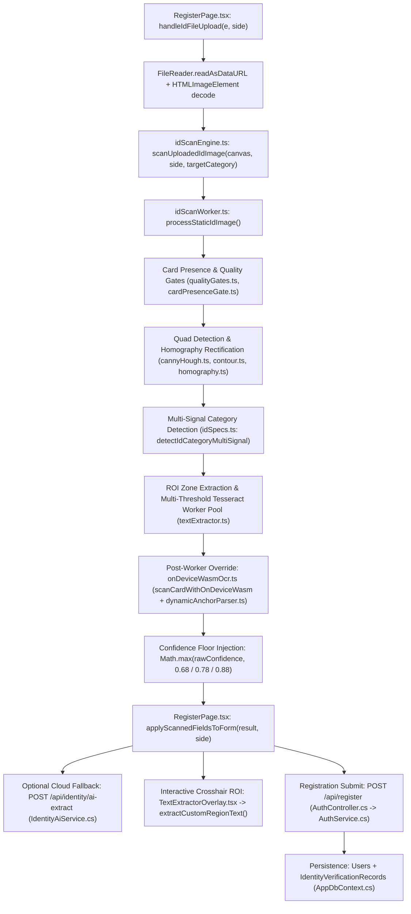

# ID OCR CURRENT STATE — REVERSE-ENGINEERED ARCHITECTURE & TRACE

## 1. End-to-End Trace (`ID Upload -> Image Processing -> OCR -> Field Parsing -> Form Mapping -> API -> Database`)

---

## 2. File-by-File Inventory of Existing Implementation

| Layer | File Path | Lines | Current Responsibility & Observed Behavior |
| :--- | :--- | :---: | :--- |
| **Template Catalogue** | `Frontend/src/Libs/Vision/idScanner/idSpecs.ts` | 1–1251 | Defines 8 flat `GovernmentIdCategory` keys (`philsys`, `drivers`, `passport`, `prc`, `umid`, `postal`, `fire`, `police`). No `version` or `side` separation in template selection, no `unknown` outcome, and no Wave 2 templates (`philhealth`, `owwa`, `comelec`, `senior_citizen`, `pwd`, `solo_parent`, `barangay`). |
| **Scan Orchestrator** | `Frontend/src/Libs/Vision/idScanner/idScanEngine.ts` | 1–522 | Runs `IdScanWorkerClient.scanStaticImage`, then unconditionally calls `scanCardWithOnDeviceWasm(sourceCanvas, targetCategory)` on lines 276–301 and overwrites worker-extracted ROI fields with whole-card OCR entries (`...Object.fromEntries(validWasmEntries)`). Also floors confidence at `0.88` on line 446 when `wasmResult.success` is true. |
| **Worker Pipeline** | `Frontend/src/Libs/Vision/idScanner/idScanWorker.ts` | 1–922 | Performs homography rectification (`856x540`), runs `detectIdCategoryMultiSignal` (defaulting to `'philsys'` on line 474 when undetected), crops ROI zones, runs regex heuristics, applies hardcoded year/DOB overrides (`2008/2009/2000/2006 -> 2004` on lines 263–265 and `2004/02/20` on lines 705–706), and enforces a minimum confidence floor (`Math.max(rawConfidence, side === 'back' ? 0.78 : 0.68)` on line 837). |
| **Text Extractor** | `Frontend/src/Libs/Vision/idScanner/textExtractor.ts` | 1–1264 | Manages a 2-worker Tesseract.js pool, 4 preprocessing variants (`adaptive`, `otsu`, `clahe`, `sauvola`), spatial band filtering, and regex-based field cleanup. Duplicates the hardcoded `2008/2009/2000/2006 -> 2004` date mutation on lines 500–502. |
| **Dynamic Anchor Parser** | `Frontend/src/Libs/Vision/idScanner/dynamicAnchorParser.ts` | 1–430 | Parses whole-card OCR text using PascalCase and keyword anchors (`SurnameFirstNameMiddleName`, `LicenseNo`, `DateofBirth`, `Address`, `Weight`, `Height`). Assumes LTO/front-side layout even when invoked on back-side or non-LTO cards. |
| **Whole-Card WASM OCR** | `Frontend/src/Libs/Vision/idScanner/onDeviceWasmOcr.ts` | 1–137 | Runs Tesseract `PSM.AUTO` across the full card canvas after an aggressive binary contrast stretch (`val < 135 ? 0 : 255`), which destroys colored/guilloche security backgrounds on LTO, PhilSys, and Passport images. |
| **Field Validators** | `Frontend/src/Libs/Vision/idScanner/validators.ts` | 1–1243 | Validates and normalizes extracted fields (`validateFullName`, `validateIdNumber`, `validateDate`, `validateAddress`, `validateSex`, `validateWeight`, `validateHeight`). Contains destructive sample-specific mutations in `validateIdNumber` for `'drivers'` (lines 702–744): rewrites leading `I/1/T/3/9` to `J`, `0Z` to `07`, and trailing `88/80/68` to `60`. |
| **Quality & Presence Gates** | `Frontend/src/Libs/Vision/idScanner/qualityGates.ts`, `cardPresenceGate.ts` | 1–414, 1–430 | Evaluates Laplacian sharpness, glare, brightness, contrast, Sobel edge density, bimodal text contrast, and portrait presence. Does not expose structured per-stage quality failure reasons in a unified `DocumentAnalysisResult` contract. |
| **Registration UI** | `Frontend/src/LANDING_PAGE/Features/Pages/RegisterPage/RegisterPage.tsx` | 1–2500 | Handles Front & Back file uploads (`handleIdFileUpload`), maps `result.fields` into React state (`applyScannedFieldsToForm`), floors confidence at `68%` (`Math.max(68, Math.round(confidenceScore * 100))` on lines 508 & 517), and displays a green `AUTOFILL VERIFIED` badge (`lines 1780–1782`) even when fields have `0%` confidence or failed validation. |
| **Interactive ROI Overlay** | `Frontend/src/LANDING_PAGE/Features/Pages/RegisterPage/TextExtractorOverlay.tsx` | 1–677 | Lets the user drag a bounding box over the uploaded ID image to run targeted ROI OCR (`extractCustomRegionText`). |
| **Backend AI Fallback** | `Backend/Features/Api/Controllers/IdentityController.cs`, `IdentityAiService.cs` | 1–22, 1–643 | Exposes `POST /api/identity/ai-extract` for optional Gemini/Azure/OpenAI fallback. Currently lacks a deterministic `POST /api/identity-documents/analyze` endpoint for structured template/version/side/provenance verification. |
| **Backend Registration & DB** | `Backend/Features/Services/Implementations/AuthService.cs`, `IdentityVerificationRecord.cs` | 1–474, 1–68 | Persists `User` (`Status = AccountStatus.Pending`, `FaceVerified = false`) and `IdentityVerificationRecord` (currently hardcoding `ConfidenceScore = 0.95` and `DocumentCheckStatus = "FORMAT_VALID"` on lines 149–150 of `AuthService.cs`). |

---

## 3. Existing Preprocessing, Classification, Side Detection, and Post-Processing Summary

1. **Preprocessing**:
   - `idScanWorker.ts` rectifies detected quads to `856x540` via `warpPerspectiveBilinear` (`homography.ts`), or falls back to center-crop/aspect resize when no quad is locked.
   - `textExtractor.ts` runs 4 grayscale/threshold variants per ROI (`adaptive`, `otsu`, `clahe`, `sauvola`) with 2x upscaling.
   - `onDeviceWasmOcr.ts` applies a single hard threshold at luminance `135` (`val < 135 ? 0 : 255`) across the whole image.
2. **Document Classification**:
   - `detectIdCategoryMultiSignal` in `idSpecs.ts` scores OCR text against keyword lists, regex patterns, and aspect ratio.
   - If the user selected a category in the dropdown (`targetCategory`), `idScanWorker.ts` trusts `targetCategory` or falls back to `'philsys'` (`line 474`). There is no `'unknown'` outcome and no version classifier (`IdVersionClassifier`).
3. **Side Detection**:
   - There is **no** automatic side classifier (`IdSideClassifier`). The pipeline blindly trusts the `side: 'front' | 'back'` argument passed from whichever upload box (`Front` or `Back`) the user clicked.
   - Uploading a back image into the front slot runs front-side ROIs and front-side anchor parsing against the back image.
4. **Confidence & Verification Semantics**:
   - OCR confidence is artificially inflated by multiple `Math.max(..., 0.68 / 0.78 / 0.88)` floors.
   - UI displays `AUTOFILL VERIFIED ({confidence}% CONFIDENCE)` without distinguishing between OCR extraction confidence, field-level format validation, front/back consistency, and official issuer verification (`not_checked`).
