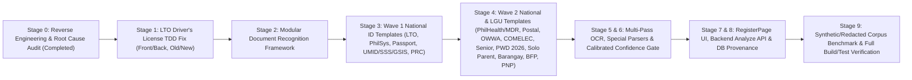

# ID OCR IMPLEMENTATION ROADMAP — STAGED EXECUTION PLAN

## Stage Overview

---

## Detailed Stage Breakdown

### Stage 0 — Reverse-Engineer Actual Application (Completed)
- Trace end-to-end flow across `idSpecs.ts`, `idScanEngine.ts`, `idScanWorker.ts`, `textExtractor.ts`, `dynamicAnchorParser.ts`, `onDeviceWasmOcr.ts`, `validators.ts`, `RegisterPage.tsx`, `AuthController.cs`, `IdentityController.cs`, `AuthService.cs`, and `IdentityVerificationRecord.cs`.
- Deliver `ID_OCR_CURRENT_STATE.md`, `ID_TEMPLATE_SUPPORT_MATRIX.md`, `OCR_ROOT_CAUSE_REPORT.md`, `OCR_BASELINE_METRICS.md`, `ID_OCR_IMPLEMENTATION_DECISIONS.md`, and `ID_OCR_IMPLEMENTATION_ROADMAP.md`.

### Stage 1 — Fix LTO Driver's License Extraction First (TDD)
- Write failing tests in `Frontend/test_ph_id_ocr_pipeline.ts` reproducing:
  1. Hardcoded birth year corruption (`2000`, `2006`, `2008`, `2009 -> 2004`).
  2. Hardcoded LTO license number mutation (`I/1/T/3/9 -> J`, `0Z -> 07`, `88/80/68 -> 60`).
  3. Separate LTO Front (`PH-LTO-DL-2021-NEW-FRONT`, `PH-LTO-DL-OLD-FRONT`) vs. Back (`PH-LTO-DL-2021-NEW-BACK`, `PH-LTO-DL-OLD-BACK`) recognition and parsing.
  4. Preservation of raw height (`1.71 m`) and weight (`52 kg`), plus separation of `idNumber`, `cardSerialNumber`, `agencyCode`, `dlCodes` vs. `restrictions`, and `conditions`.
  5. Strict rejection of zero-confidence or invalid fields (`NOT_EXTRACTED` / `REQUIRES_REVIEW`).
- Remove hardcoded overrides in `idScanWorker.ts`, `textExtractor.ts`, and `validators.ts`, and prevent `idScanEngine.ts` from overwriting valid ROI fields or running front-side anchor parsing on `side === 'back'`.

### Stage 2 — Build Modular Document-Recognition Pipeline
- Implement `Frontend/src/Libs/Vision/idScanner/idTemplateRegistry.ts` and `Frontend/src/Libs/Vision/idScanner/idRecognitionPipeline.ts` providing:
  - `DocumentQualityAnalyzer`
  - `DocumentBoundaryDetector` & `DocumentRectifier`
  - `IdTypeClassifier`, `IdSideClassifier`, `IdVersionClassifier`
  - `IdTemplateRegistry`
  - `ImagePreprocessor` & `RegionOcrService`
  - `BarcodeQrReader` & `PassportMrzParser`
  - `IdFieldExtractor`, `FieldNormalizer`, `DocumentFieldValidator`
  - `FrontBackConsistencyChecker`, `DocumentAuthenticityVerifier`, `HumanReviewDecisionService`

### Stage 3 — Wave 1 High-Priority Philippine ID Templates
- Register source-backed, version-aware templates for:
  1. **LTO Driver's License**: `PH-LTO-DL-2021-NEW-FRONT`, `PH-LTO-DL-2021-NEW-BACK`, `PH-LTO-DL-OLD-FRONT`, `PH-LTO-DL-OLD-BACK`.
  2. **PhilSys National ID**: `PH-PSA-PHILSYS-PVC-FRONT`, `PH-PSA-PHILSYS-PVC-BACK`, `PH-PSA-EPHILID-PAPER`, `PH-PSA-NATIONAL-ID-DIGITAL` (PCN vs. PSN separation).
  3. **Philippine Passport**: `PH-DFA-PASSPORT-TD3-DATAPAGE` (VIZ + ICAO 9303 TD3 MRZ check-digit verifier).
  4. **UMID / SSS / GSIS**: `PH-UMID-GENERIC-FRONT`, `PH-UMID-GENERIC-BACK`, `PH-SSS-ID-FRONT`, `PH-GSIS-ECARD-FRONT`.
  5. **PRC Professional ID**: `PH-PRC-PIC-FRONT`, `PH-PRC-PIC-BACK`, `PH-PRC-EPIC-DIGITAL`.

### Stage 4 — Wave 2 National & Local Philippine ID Templates
- Register source-backed templates for:
  6. **PhilHealth**: `PH-PHILHEALTH-CARD-CURRENT`, `PH-PHILHEALTH-IPHILHEALTHY-2011`, `PH-PHILHEALTH-MDR-DOCUMENT`.
  7. **Postal ID**: `PH-POSTAL-ID-2016-FRONT`, `PH-POSTAL-ID-2016-BACK`.
  8. **OWWA e-Card**: `PH-OWWA-ECARD-FRONT`, `PH-OWWA-ECARD-DIGITAL`.
  9. **COMELEC**: `PH-COMELEC-VOTERS-ID-CARD`, `PH-COMELEC-VOTERS-CERTIFICATE-DOC`.
  10. **Senior Citizen, PWD (Legacy & 2026 Unified), Solo Parent, Barangay, BFP, PNP**:
      - `PH-LGU-SENIOR-CITIZEN-ID`
      - `PH-NCDA-PWD-ID-LEGACY-LGU`, `PH-NCDA-PWD-ID-2026-UNIFIED` (with NCDA AO 001 privacy & biometric profiling guard)
      - `PH-LGU-SOLO-PARENT-ID`
      - `PH-BARANGAY-ID-CARD`
      - `PH-DILG-BFP-ID-FRONT`, `PH-DILG-PNP-ID-FRONT`

### Stages 5, 6, 7 & 8 — Special Parsers, Provenance Model, UI, API & Persistence
- Expose `ExtractedField<T>` provenance and `DocumentAnalysisResult` in `IdScanResult`.
- Update `RegisterPage.tsx` with expanded Philippine ID family/version selector, side-mismatch alerts, field-level provenance badges (`ACCEPTED_FOR_PREFILL`, `REQUIRES_REVIEW`, `NOT_EXTRACTED`), truthful OCR status badges, and PWD privacy compliance.
- Add `POST /api/identity-documents/analyze` to `IdentityController.cs` / `IdentityAiService.cs` and persist calibrated confidence, version, side, and verification status in `IdentityVerificationRecord`.

### Stage 9 — Gold-Standard Corpus Testing & Verification
- Execute `Frontend/test_ph_id_ocr_pipeline.ts`, existing vision tests, `npx tsc --noEmit`, `npm run build`, and `dotnet test`.
