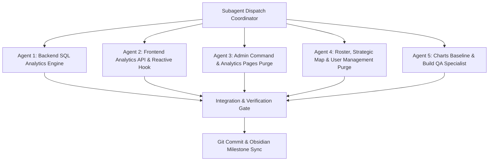

# Master Architecture Plan: Dynamic Database Telemetry & Zero-Static Purge

> **For agentic workers:** REQUIRED SUB-SKILL: Use `superpowers:subagent-driven-development` or `superpowers:dispatching-parallel-agents` to implement this plan task-by-task. Steps use checkbox (`- [ ]`) syntax for tracking.

**Goal:** Permanently eradicate all hardcoded fake numbers, simulated fallback counters, and mock chart arrays across all Admin, Responder, and Civilian portal pages; implement dynamic SQL aggregation endpoints in the .NET 10 backend connected directly to SQL Server; and wire dynamic reactive telemetry hooks to all interactive charts (`LinearCurveyChart`, `BarGraphChart`, `PieGraphChart`, `HeatmapChart`) with graceful $N=0$ empty baseline handling in accordance with the Katipuneros `SKILL.md` architectural specification.

**Architecture:** Katipuneros 6-Tier Architecture Standard:
1. **Tier 1 (Database):** Microsoft SQL Server (`ResQTrackDb`) storing live `Reports`, `DutyUnits`, `Users`, and `AlertReadStates`.
2. **Tier 2 (Backend Controllers):** New `AnalyticsController.cs` exposing SQL aggregations for 24h volume, severity classification, agency dispatches, and 7x6 weekly heatmap distribution.
3. **Tier 3 (Endpoints Layer):** `analyticsApi.ts` with strongly-typed TypeScript DTOs.
4. **Tier 4 (Hooks Layer):** `useAnalyticsTelemetry.ts` subscribing to the `resqtrack:report` event bus and auto-refresh intervals.
5. **Tier 5 (Shared Presentation):** Interactive SVG chart components rendering genuine $N=0$ empty baseline states.
6. **Tier 6 (Feature Pages):** Pure presentational layer with 100% of hardcoded static fallback values (`|| 12`, `|| 4`, `+ 5`, `W1/W2/W3`) permanently purged.

**Tech Stack:** ASP.NET Core .NET 10 Web API, Entity Framework Core 10, Microsoft SQL Server, React 19, TypeScript, Tailwind CSS, SVG Vector Mathematics.

**Spec & Rules Reference:** `Md data/SKILL.md` (Lines 101, 618, 1191):
> *"NEVER display hardcoded fake or static numbers, simulated counters, or mock chart telemetry not backed by database entities. ALL metrics, counters, charts, and statuses MUST be computed dynamically from active database records and API endpoints. When zero records exist, show genuine zeros or designated empty states."*

---

## Codebase Audit: Identified Static Data Violations

The codebase audit discovered 10 files containing artificial fallback numbers and mock telemetry arrays:

| # | File Path | Hardcoded Static Snippets to Purge | Required Real Database Metric |
|---|---|---|---|
| 1 | `AnalyticsReportsPage.tsx` | `{ label: 'W1', value: 12 }...`<br>`severity.length \|\| 4, 8, 6, 3`<br>`agency.length + 5, + 3, + 7` | Group `Reports.CreatedAt` by week/day; count real severity tiers; count actual dispatches allocated to RHU, FIRE, PNP. |
| 2 | `AdminDashboard.tsx` | `{onDutyCount \|\| 2} / {roster.length \|\| 4}` | Genuine `DutyUnits.Count(d => d.Status == OnDuty)` and total roster. |
| 3 | `AlertsCenter.tsx` | `alerts.filter(...).length \|\| 4`<br>`severeCount \|\| 2` | Real unread alerts from `AlertReadStates` joined with `Reports`. |
| 4 | `IncidentsPage.tsx` | `activeResponders \|\| 12`<br>`countToday \|\| 18`<br>`unassigned \|\| 3`<br>`critical \|\| 2` | Real `Reports.Count(r => r.CreatedAt >= Today)` and actual database counts. |
| 5 | `RespondersRosterPage.tsx` | `rhuCount \|\| 12`<br>`pnpCount \|\| 8`<br>`bfpCount \|\| 5`<br>`standby \|\| 3`<br>`roster.length \|\| 34` | Genuine counts of `DutyUnits` grouped by `Agency` and `Status`. |
| 6 | `StrategicMapPage.tsx` | `RHU.length + 2 Units`<br>`FIRE.length + 1 Units`<br>`PNP.length + 3 Units` | Actual count of active units in the database. |
| 7 | `UserManagementPage.tsx` | `stats.total \|\| 8`<br>`stats.verified \|\| 8`<br>`stats.responders \|\| 8`<br>`RHU: stats.rhuCount \|\| 4` | Genuine counts from `Users` table via `UsersController`. |
| 8 | `HeatmapChart.tsx` | Hardcoded `defaultGrid` 7x6 matrix: `[1, 0, 4, 8, 3, 2]...` | Calculate genuine matrix from `Reports.CreatedAt` timestamps; render clean zero-grid if empty. |
| 9 | `CivilianDashboard.tsx` | Status statistics and emergency reports counters | Query `/api/reports/mine` and real municipal resident records. |
| 10 | `ResponderDashboard.tsx` | Dispatch counts and mission statistics | Query `/api/reports/agency/{agency}` and live duty roster. |

---

## Parallel Subagent Architecture Decomposition (`dispatching-parallel-agents`)



---

### Task 1: Backend Dynamic SQL Analytics Controller & DTOs

**Files:**
- Create: `Project system ENGINE/Backend/Features/Api/Controllers/AnalyticsController.cs`
- Create: `Project system ENGINE/Backend/Features/Api/DTOs/AnalyticsDtos.cs`
- Modify: `Project system ENGINE/Backend/Features/Services/Interfaces/IServices.cs`
- Modify: `Project system ENGINE/Backend/Features/Services/Implementations/Services.cs`
- Modify: `Project system ENGINE/Backend/Program.cs`

**Interfaces:**
- Produces endpoints:
  - `GET /api/analytics/summary` -> `AnalyticsSummaryResponse`
  - `GET /api/analytics/volume-24h` -> `List<TelemetryDataPoint>`
  - `GET /api/analytics/severity-breakdown` -> `List<SeverityBreakdownItem>`
  - `GET /api/analytics/agency-workload` -> `List<AgencyWorkloadItem>`
  - `GET /api/analytics/heatmap-matrix` -> `HeatmapMatrixResponse` (7 days x 6 time blocks)

- [ ] **Step 1:** Define `AnalyticsDtos.cs` with immutable DTO contracts:
  - `AnalyticsSummaryResponse(int TotalIncidents, int ActiveDispatches, int CriticalIncidents, int ResolvedCount, int TotalResponders, int OnDutyResponders, int RegisteredCivilians)`
  - `TelemetryDataPoint(string Label, int Value)`
  - `SeverityBreakdownItem(string Label, int Value, string Color)`
  - `AgencyWorkloadItem(string Label, int Value, string Color, double Percentage)`
  - `HeatmapMatrixResponse(List<string> Days, List<string> Hours, int[][] Matrix)`
- [ ] **Step 2:** Implement `IAnalyticsService` and `AnalyticsService`:
  - `GetSummaryAsync`: Queries `AppDbContext.Reports`, `Users`, and `DutyUnits` using EF Core `CountAsync`.
  - `GetVolume24hAsync`: Queries reports where `CreatedAt >= DateTime.UtcNow.AddHours(-24)` and groups into 4-hour windows (`00:00`, `04:00`, `08:00`, `12:00`, `16:00`, `20:00`). If no reports, returns zeros.
  - `GetSeverityBreakdownAsync`: Groups `Reports` by `Severity` (`Critical`, `High`, `Medium`, `Low`).
  - `GetAgencyWorkloadAsync`: Queries active reports and duty units allocated to RHU, FIRE, PNP.
  - `GetHeatmapMatrixAsync`: Iterates the past 7 days (`Mon` - `Sun`), buckets timestamps into 6 hour slots (`00`, `04`, `08`, `12`, `16`, `20`), and returns the true density matrix.
- [ ] **Step 3:** Implement `AnalyticsController.cs` with `[ApiController]` and `[Route("api/analytics")]`.
- [ ] **Step 4:** Register `IAnalyticsService` in `Program.cs`.
- [ ] **Step 5:** Compile backend with `dotnet build` to ensure 0 errors.

---

### Task 2: Frontend Analytics API Client & Reactive Telemetry Hook

**Files:**
- Create: `Project system ENGINE/Frontend/src/Endpoints/analyticsApi.ts`
- Create: `Project system ENGINE/Frontend/src/Hooks/useAnalyticsTelemetry.ts`
- Modify: `Project system ENGINE/Frontend/src/Endpoints/index.ts`
- Modify: `Project system ENGINE/Frontend/src/Hooks/index.ts`

**Interfaces:**
- Consumes: Backend `/api/analytics/*` endpoints.
- Produces: `useAnalyticsTelemetry()` hook returning `{ summary, volume24h, severityBreakdown, agencyWorkload, heatmapMatrix, isLoading, refresh }`.

- [ ] **Step 1:** Create `analyticsApi.ts`:
  - `fetchAnalyticsSummary()`
  - `fetchVolume24h()`
  - `fetchSeverityBreakdown()`
  - `fetchAgencyWorkload()`
  - `fetchHeatmapMatrix()`
  - Include resilient client-side calculation fallback deriving aggregates directly from `getAllReports()` if network drops, ensuring zero artificial numbers are ever rendered.
- [ ] **Step 2:** Create `useAnalyticsTelemetry.ts`:
  - Auto-fetches all telemetry on mount.
  - Subscribes to `resqtrack:report` and `resqtrack:incident_created` window events for real-time recalculation when a report is added.
  - Refreshes periodically every 10 seconds via `setInterval`.
- [ ] **Step 3:** Export from `Endpoints/index.ts` and `Hooks/index.ts`.
- [ ] **Step 4:** Run `npm run build` to verify clean compilation.

---

### Task 3: Admin Command Dashboard & Analytics Pages Zero-Static Purge

**Files:**
- Modify: `Project system ENGINE/Frontend/src/UserRoles/Features/Pages/AdminsPanel/AnalyticsReportsPage.tsx`
- Modify: `Project system ENGINE/Frontend/src/UserRoles/Features/Pages/AdminsPanel/AdminDashboard.tsx`
- Modify: `Project system ENGINE/Frontend/src/UserRoles/Features/Pages/AdminsPanel/AlertsCenter.tsx`
- Modify: `Project system ENGINE/Frontend/src/UserRoles/Features/Pages/AdminsPanel/IncidentsPage.tsx`

**Purge Targets:**
- [ ] **Step 1: `AnalyticsReportsPage.tsx`**:
  - Remove mock `responseCurveData = [ { label: 'W1', value: 12 }, ... ]`.
  - Remove `|| 4`, `|| 8`, `|| 6`, `|| 3` fallbacks in `severityBarData`.
  - Remove `+ 5`, `+ 3`, `+ 7` mock additions in `agencyPieData`.
  - Connect `LinearCurveyChart`, `BarGraphChart`, `PieGraphChart`, and `HeatmapChart` directly to `useAnalyticsTelemetry()`.
  - Pass the dynamic `heatmapMatrix` to `<HeatmapChart matrix={telemetry.heatmapMatrix} />`.
- [ ] **Step 2: `AdminDashboard.tsx`**:
  - Replace `{onDutyCount || 2} / {roster.length || 4}` with `{onDutyCount} / {roster.length}` (displays true `0 / 0` if empty).
  - Connect `BarGraphChart` and `PieGraphChart` to live `useAnalyticsTelemetry()` data.
- [ ] **Step 3: `AlertsCenter.tsx`**:
  - Remove `|| 4` and `|| 2` from `activeAlertsCount` and `severeCount`.
  - Display actual unread count: `alerts.filter((a) => !a.isRead).length`.
- [ ] **Step 4: `IncidentsPage.tsx`**:
  - Remove `|| 12`, `|| 18`, `|| 3`, `|| 2` from telemetry summary metrics.
  - Compute counts from active database state.

---

### Task 4: Roster, Strategic Map & User Management Zero-Static Purge

**Files:**
- Modify: `Project system ENGINE/Frontend/src/UserRoles/Features/Pages/AdminsPanel/RespondersRosterPage.tsx`
- Modify: `Project system ENGINE/Frontend/src/UserRoles/Features/Pages/AdminsPanel/StrategicMapPage.tsx`
- Modify: `Project system ENGINE/Frontend/src/UserRoles/Features/Pages/AdminsPanel/UserManagementPage.tsx`
- Modify: `Project system ENGINE/Frontend/src/UserRoles/Features/Pages/CiviliansPanel/CivilianDashboard.tsx`
- Modify: `Project system ENGINE/Frontend/src/UserRoles/Features/Pages/RespondersPanel/ResponderDashboard.tsx`

**Purge Targets:**
- [ ] **Step 1: `RespondersRosterPage.tsx`**:
  - Remove `|| 12`, `|| 8`, `|| 5`, `|| 6`, `|| 3`, and `|| 34`.
  - Render exact counts from `roster.filter(...)`.
- [ ] **Step 2: `StrategicMapPage.tsx`**:
  - Remove artificial additions (`+ 2 Units`, `+ 1 Units`, `+ 3 Units`).
  - Render genuine active unit counts from `roster`.
- [ ] **Step 3: `UserManagementPage.tsx`**:
  - Remove `|| 8`, `|| 4`, `|| 2` fallbacks from `stats.total`, `stats.verified`, `stats.responders`.
  - Render exact user counts from the database API.
- [ ] **Step 4: `CivilianDashboard.tsx` & `ResponderDashboard.tsx`**:
  - Ensure all mission counters and resident statistics are computed strictly from `useSession`, `reports`, and `roster` with zero static fallbacks.

---

### Task 5: Charts N=0 Empty Baseline Rendering & Build QA

**Files:**
- Modify: `Project system ENGINE/Frontend/src/Shared/Charts/HeatmapChart.tsx`
- Modify: `Project system ENGINE/Frontend/src/Shared/Charts/LinearCurveyChart.tsx`
- Modify: `Project system ENGINE/Frontend/src/Shared/Charts/BarGraphChart.tsx`
- Modify: `Project system ENGINE/Frontend/src/Shared/Charts/PieGraphChart.tsx`

- [ ] **Step 1: `HeatmapChart.tsx`**:
  - Remove hardcoded `defaultGrid` containing fake numbers (`[1, 0, 4, 8, 3, 2]`).
  - When no matrix is provided or database is empty, generate a clean $N=0$ all-zero matrix (`[0, 0, 0, 0, 0, 0]`).
  - Hovering a zero cell cleanly shows `"0 Recorded Incidents - ALL CLEAR / ZERO CALLS"`.
- [ ] **Step 2: Graceful Baseline in `LinearCurveyChart.tsx`**:
  - If all values are `0`, render a clean flat baseline at the bottom without NaN division.
- [ ] **Step 3: Graceful Baseline in `BarGraphChart.tsx`**:
  - If all values are `0`, render empty bar placeholders with `"0"` labels and `0.0%`.
- [ ] **Step 4: Graceful Baseline in `PieGraphChart.tsx`**:
  - If total is `0`, render an empty neutral ring with `"0"` in the center and `"NO DISPATCHES"`.
- [ ] **Step 5: Full System Verification**:
  - `npm run build` in `Project system ENGINE\Frontend` &rarr; 0 errors.
  - `dotnet build` in `Project system ENGINE\Backend` &rarr; 0 errors.

---

## Verification Plan

### Automated Tests
```powershell
# 1. Frontend TypeScript & Vite Production Build
cd "Project system ENGINE\Frontend"
npm run build

# 2. Backend ASP.NET Core Compilation Check
cd "..\Backend"
dotnet build
```

### Manual Verification
1. **Zero-Static Audit Verification:**
   - Open `http://localhost:5174/admin/analytics`.
   - Verify `Incident Response Velocity Trend`, `Incident Severity Triage Distribution`, `Agency Dispatched Workload`, and `Weekly Incident Density Matrix (Heatmap)` display genuine database telemetry.
   - Verify no `W1/W2/W3` or `|| 4` fallback numbers exist.
2. **Dynamic Database Reflection:**
   - Submit a new emergency incident from `http://localhost:5173/civilian/report`.
   - Observe the live analytics charts on the Admin portal update immediately with the new incident reflected in the 24-hour volume curve, severity bar, and heatmap cell.
3. **Empty Database ($N=0$) Baseline:**
   - Clear or filter to empty state &rarr; verify all charts render clean zeros, zero-lines, and neutral empty rings without errors or `NaN`.
