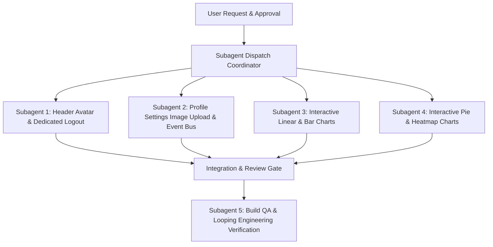

# Header Avatar Sync, Profile Modal, Dedicated Logout & Interactive Charts Implementation Plan

> **For agentic workers:** REQUIRED SUB-SKILL: Use superpowers:subagent-driven-development (recommended) or superpowers:executing-plans to implement this plan task-by-task. Steps use checkbox (`- [ ]`) syntax for tracking.

**Goal:** Synchronize the header profile avatar with profile settings image uploads, add a dedicated topbar logout button, transform avatar click into an informative floating profile card, and make all chart components (Linear Curvey, Bar, Pie/Donut, and Heatmap) fully interactive with smooth hover animations, coordinate tooltips, and status inspections across Admin, Responder, and Civilian portals.

**Architecture:** Katipuneros 6-Tier Architecture Standard + SVG Vector Math with zero heavy external charting dependencies:
1. **Avatar & Profile Subsystem:** Reactive `resqtrack:avatar-updated` CustomEvent bus linking `localStorage`, `CivilianProfile.tsx`, `ResponderProfile.tsx`, `SettingsPage.tsx`, and `UserSessionChip.tsx`.
2. **Dedicated Header Logout:** Distinct power/exit button with clear visual separation from avatar profile modal trigger.
3. **Interactive Charts Suite:** Pure React SVG vector calculations in `@/Shared/Charts/` with mouse pointer tracking, dynamic tooltip HUD cards, smooth CSS/SVG transitions, and slice/bar hover elevations.

**Tech Stack:** React 19, TypeScript, Tailwind CSS, SVG Bezier Math, ASP.NET Core .NET 10.

**Spec:** User directive for header avatar synchronization, dedicated logout, floating profile modal, and interactive graph hover tooltips.

---

## Global Constraints

- **Color Theme Invariant:** Strict preservation of Deep Maroon (`#14020a`, `#340313`, `#44212c`), Command Slate (`#0f172a`, `#1e293b`), Tactical Crimson/Rose (`#ff5c74`, `#e8114c`), and agency accents (RHU: `#0284c7`, FIRE: `#ea580c`, PNP: `#3b82f6`, LDRRMO: `#dc2626`).
- **Zero Heavy Charting Libraries:** Do not install bloated chart packages (Chart.js, Recharts, D3); maintain clean, ultra-fast, self-contained SVG primitives with full mathematical precision.
- **Zero API/Database Regression:** Preserve all endpoint contracts, DTOs, and session storage formats.
- **TypeScript Strictness:** 0 compilation errors (`tsc -b && vite build`) and zero `any` usage.

---

## Parallel Subagent Task Decomposition (`dispatching-parallel-agents`)



---

### Task 1: Header Profile Avatar Sync, Floating Profile Modal & Dedicated Logout Button

**Files:**
- Modify: `Project system ENGINE/Frontend/src/LayoutBars/UserSessionChip.tsx`
- Modify: `Project system ENGINE/Frontend/src/LayoutBars/Header.tsx`
- Create: `Project system ENGINE/Frontend/src/Shared/ProfileFloatingModalCard.tsx`
- Test: Verify in browser and build verification

**Interfaces:**
- Consumes: `useSession`, `localStorage.getItem('resqtrack_user_avatar')`, `resqtrack:avatar-updated` CustomEvent.
- Produces: Dynamic image avatar with SVG fallback, floating profile modal card trigger, and separate standalone logout button.

- [ ] **Step 1:** Create `ProfileFloatingModalCard.tsx` in `src/Shared/`:
  - Renders user's enlarged avatar image, verified glowing ring, full name, role badge, unit assignment, PhilSys/PRC badge ID, account email, municipal status.
  - Includes a direct button "Open Full Profile Settings" linking to the user's role settings page.
  - Dismisses on outside click or `Escape` key.
- [ ] **Step 2:** Refactor `UserSessionChip.tsx`:
  - Replace direct logout `onClick` with profile modal toggle (`isProfileModalOpen`).
  - Read avatar from `resqtrack_user_avatar` in `localStorage` on mount.
  - Subscribe to `resqtrack:avatar-updated` window events for instant updates when photo is changed in settings.
  - Render `` tag with `object-cover rounded-full` when avatar image is present, with fallback to SVG initials.
- [ ] **Step 3:** Update `Header.tsx`:
  - Place a dedicated **Logout Button** right after `UserSessionChip`:
    - Tactical exit door SVG icon.
    - Hover glow (`text-rose-400 hover:text-rose-200 hover:bg-rose-950/80 border border-rose-900/40`).
    - Executes clean session revocation (`POST /api/logout`), clears credentials, and redirects to `/login`.
- [ ] **Step 4:** Run `npm run build` to verify clean compilation.

---

### Task 2: Profile Settings Image Upload & Synchronization Engine

**Files:**
- Modify: `Project system ENGINE/Frontend/src/UserRoles/Features/Pages/CiviliansPanel/CivilianProfile.tsx`
- Modify: `Project system ENGINE/Frontend/src/UserRoles/Features/Pages/RespondersPanel/ResponderProfile.tsx`
- Modify: `Project system ENGINE/Frontend/src/UserRoles/Features/Pages/AdminsPanel/SettingsPage.tsx`

**Interfaces:**
- Consumes: File input / FileReader base64 PNG data URL or camera capture snapshot.
- Produces: `localStorage.setItem('resqtrack_user_avatar', dataUrl)` and dispatches `window.dispatchEvent(new CustomEvent('resqtrack:avatar-updated', { detail: { avatar: dataUrl } }))`.

- [ ] **Step 1:** Enhance `CivilianProfile.tsx` with Profile Picture Selector:
  - Add an interactive camera/upload badge over the resident avatar.
  - On file selection (or camera snapshot), validate image, read as base64 PNG data URL, save to `localStorage`, and fire `resqtrack:avatar-updated`.
- [ ] **Step 2:** Enhance `ResponderProfile.tsx` with Official Badge Photo Upload:
  - Add an interactive badge photo changer for field officers (RHU Medics, BFP Firefighters, PNP Officers).
  - Sync with `resqtrack_user_avatar` and trigger the global update event.
- [ ] **Step 3:** Enhance `SettingsPage.tsx` with Admin Officer Avatar Management:
  - Allow LDRRMO Director / Administrator to update command avatar photo.
- [ ] **Step 4:** Verify that changing the photo in any of these profile pages updates the top-right header avatar instantly without needing a full page reload.

---

### Task 3: Interactive Linear Curvey Chart & Bar Graph Chart with Tooltips & Animations

**Files:**
- Modify: `Project system ENGINE/Frontend/src/Shared/Charts/LinearCurveyChart.tsx`
- Modify: `Project system ENGINE/Frontend/src/Shared/Charts/BarGraphChart.tsx`

**Interfaces:**
- Consumes: `DataPoint[]` array with numerical values and labels.
- Produces: Interactive hover state, tracking crosshair guideline, glowing data point expansion, floating tactical HUD tooltip with X/Y coordinates, and status classification.

- [ ] **Step 1:** Refactor `LinearCurveyChart.tsx`:
  - Add state `activePointIndex: number | null` and mouse move tracker over the SVG viewport.
  - When pointer moves across the curve:
    - Compute the nearest data point along the X-axis.
    - Render a vertical laser guideline (`stroke-dasharray="2,2" stroke="#ff5c74"`).
    - Expand active point radius from `r=4` to `r=7` with outer glowing pulse ring.
    - Render a floating tactical HUD tooltip anchored above the active point displaying:
      - Time / Date Label (X-Axis)
      - Numerical incident / telemetry value (Y-Axis)
      - Velocity / Volume Status indicator (`SURGE`, `ELEVATED`, `NOMINAL`, `LOW`).
  - Add smooth CSS transitions (`transition: all 0.2s cubic-bezier(0.4, 0, 0.2, 1)`).
- [ ] **Step 2:** Refactor `BarGraphChart.tsx`:
  - Add state `hoveredBarIndex: number | null`.
  - When hovering a bar:
    - Elevate bar with smooth translation (`transform: translateY(-5px)`).
    - Dim inactive sibling bars (`opacity: 0.45`) to highlight focus.
    - Render floating HUD tooltip above the bar showing:
      - Category / Severity Tier
      - Raw numerical count
      - Percentage contribution to total
      - Status classification pill (`CRITICAL SOS`, `PRIORITY ALERT`, `NORMAL MONITORING`).
  - Add bar shadow glow matching the individual bar color.
- [ ] **Step 3:** Run `npm run build` to verify clean compilation.

---

### Task 4: Interactive Pie / Donut Chart & Heatmap with Radial Expansion & Density Inspection

**Files:**
- Modify: `Project system ENGINE/Frontend/src/Shared/Charts/PieGraphChart.tsx`
- Modify: `Project system ENGINE/Frontend/src/Shared/Charts/HeatmapChart.tsx`

**Interfaces:**
- Consumes: Workload distribution slices and 7x6 density matrix.
- Produces: Radial slice expansion on hover, center telemetry inspection, cell highlight glow, and interactive heat distribution tooltips.

- [ ] **Step 1:** Refactor `PieGraphChart.tsx`:
  - Add state `hoveredSliceIndex: number | null`.
  - When hovering over a slice or its corresponding legend item:
    - Translate slice outward along its radial angle bisector by `6px` (`transform: translate(...)` with smooth SVG transition).
    - Slightly dim non-hovered slices (`opacity: 0.4`).
    - Center donut text dynamically transitions to show:
      - Active agency name (e.g., `RHU EMS`, `BFP FIRE`, `PNP POLICE`)
      - Exact percentage (`%`) of fleet workload
      - Raw active dispatches count
    - Render interactive floating tooltip with agency status.
- [ ] **Step 2:** Refactor `HeatmapChart.tsx`:
  - Add state `hoveredCell: { day: string; hour: string; value: number } | null`.
  - When hovering over any matrix cell:
    - Cell scales up (`scale-125 z-20`) with tactical hairline border and colored beacon glow.
    - Simultaneously highlight corresponding Day (Y-axis) and Hour (X-axis) label headers.
    - Render interactive floating tooltip showing:
      - Sector Time Window (e.g. `Friday 12:00 - 16:00`)
      - Incident frequency count
      - Risk Density Status (`CRITICAL CONGESTION`, `HIGH RISK`, `MODERATE`, `CLEAR`).
      - Recommended dispatch posture.
- [ ] **Step 3:** Run `npm run build` to verify clean compilation.

---

### Task 5: Closed-Loop Verification & Looping Engineering Check

- [ ] **Step 1:** Run `npm run build` (`tsc -b && vite build`) and confirm 0 errors, 0 warnings.
- [ ] **Step 2:** Run `dotnet build` on the backend and confirm 0 errors.
- [ ] **Step 3:** Test live browser interaction:
  - Upload avatar image in `CivilianProfile` & verify header avatar updates instantly.
  - Click avatar & verify floating profile modal card appears with full info.
  - Click dedicated logout button & verify session signs out properly.
  - Hover over all 4 charts in Admin, Responder, and Civilian dashboards & verify smooth animations and coordinate tooltips.
- [ ] **Step 4:** Record deliverables in Obsidian Memory Engine (`log.md`, session notes).

---

## Verification Plan

### Automated Tests
```powershell
# 1. Frontend TypeScript & Vite Production Build
cd "Project system ENGINE\Frontend"
npm run build

# 2. Backend ASP.NET Core Compilation Check
cd "..\Backend"
dotnet build
```

### Manual Verification
1. **Avatar Photo Synchronization:**
   - Go to `http://127.0.0.1:5173/civilian/profile` or `/responder/profile`.
   - Click "Change Avatar" / upload an image.
   - Observe the top-right header avatar immediately updating to display the new photo.
2. **Profile Modal & Logout Button:**
   - Click the top-right avatar &rarr; Confirm floating profile modal opens showing name, role, agency badge, and ID.
   - Click outside the modal &rarr; Confirm it closes cleanly.
   - Click the red logout button right next to the avatar &rarr; Confirm immediate session sign-out and redirect to `/login`.
3. **Interactive Charts & Tooltips:**
   - Go to `http://127.0.0.1:5174/admin/analytics` and `/admin/dashboard`.
   - Hover cursor over the Linear Curvey Chart &rarr; verify guideline tracks pointer, point pulses, and tooltip displays X-axis time, Y-axis value, and status.
   - Hover cursor over the Bar Graph &rarr; verify bar elevates and tooltip displays severity, value, and status.
   - Hover cursor over the Pie/Donut Chart &rarr; verify slice expands outward, center displays percentage, and tooltip shows agency workload.
   - Hover cursor over the Heatmap &rarr; verify cell scales up, row/column labels illuminate, and tooltip displays exact day, hour, and density risk rating.
