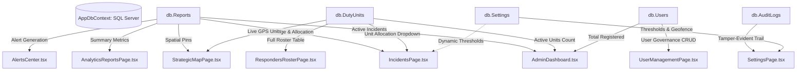

# Admin Relational Sync, Telemetry Algorithms & Universal Lucide Icon Overhaul Plan

> **For agentic workers:** REQUIRED SUB-SKILL: Use `superpowers:subagent-driven-development` or `superpowers:dispatching-parallel-agents` to implement this plan task-by-task. Steps use checkbox (`- [ ]`) syntax for tracking.

**Goal:** Establish end-to-end relational data synchronization across all LDRRMO Admin and First Responder modules, mathematically formalize all underlying algorithmic calculations (TIVA, Haversine ETA, MAP, GCS, Fire Hydraulics, Laplacian Blur), and execute a 100% universal migration to `lucide-react` icons across all UI pages, components, headers, sidebars, and modals.

**Architecture:** ASP.NET Core 10 Web API + EF Core (SQL Server) with reactive frontend consumption via React 19 + TypeScript + Tailwind CSS. Universal expression bodies (`=>`), strict zero-mock database telemetry ($N=0$ empty states), and standard tree-shakeable `lucide-react` vector components.

**Tech Stack:** React 19, TypeScript 6.0, Tailwind CSS 3.4, `lucide-react` 1.61.0, Leaflet 1.9, ASP.NET Core 10, Microsoft SQL Server.

**Spec:** [`admin_relational_sync_and_lucide_icon_overhaul_plan.md`](file:///C:/Users/provu/.gemini/antigravity-cli/brain/f4db8cc5-1635-43fd-94bb-ed301c4741f1/admin_relational_sync_and_lucide_icon_overhaul_plan.md)

---

## Global Constraints

- **Strictly `lucide-react` Icons ONLY**: Zero inline raw SVG icons, zero `<use href="#i-*"/>` SVG sprites, zero emoji icons in UI buttons, tabs, or badges.
- **Zero-Static Telemetry Invariant** (`SKILL.md:1191` & `AGENTS.md:61`): All metrics, tables, rosters, and charts must bind dynamically to database endpoints with genuine $N=0$ states.
- **Katipuneros Universal Lambdas (`=>`)**: Mandatory expression bodies for all C# controllers/services and TypeScript helper functions.
- **Dual-Port RBAC Isolation**: Port 5174 for LDRRMO Admin; Port 5173 for Civilians and Responders; Port 5000 for ASP.NET Core API.
- **Deterministic 3-Phase Verification**: Phase 1 Frontend Build (`tsc -b && vite build`), Phase 2 Backend Build (`dotnet build`), Phase 3 Zero-Static Audit & Git Commit.

---

## Section 1: Backend Function to Frontend Button, Display, and Value Mapping

| Backend Controller & Endpoint | HTTP Method | Frontend Caller / Hook | Triggering Button / UI Event | Data Values Displayed & Relational Database Entity |
|---|---|---|---|---|
| **AuthController**<br>`/api/login` | `POST` | `authApi.ts`<br>`useSession.ts` | "Access Command Center"<br>"Sign In" button in `Login.tsx`, `AdminLoginPage.tsx` | Authenticates email + scrypt password hash; returns JWT/session token; writes to `db.Sessions`; stores cookie; returns `TargetDashboardUrl` routing user dynamically by role. |
| **AuthController**<br>`/api/session` | `GET` | `useSession.ts` | App initialization & route guard mount in `LayoutWrappers.tsx` | Resolves user identity from `db.Sessions` join `db.Users`; displays full name, role badge, agency, city/barangay, face verification badge, session expiry. |
| **AuthController**<br>`/api/logout` | `POST` | `useSession.ts` | Logout button in `Header.tsx`, `Sidebar.tsx`, `ProfileFloatingModalCard.tsx` | Invalidates `Session.IsRevoked = true` in database; deletes cookie; clears localStorage; redirects to `/login`. |
| **ReportsController**<br>`/api/reports` | `POST` | `reportsApi.ts` | "TRANSMIT EMERGENCY REPORT" in `ReportAccidentPage.tsx`, `AccidentReportModal.tsx` | Inserts new incident into `db.Reports` (`ReferenceCode`, `Title`, `Category`, `Severity`, `Latitude`, `Longitude`, `GpsAccuracy`, `ImageCapturePath`, `LaplacianVariance`, `Status = Pending`); emits `resqtrack:report` event bus signal. |
| **ReportsController**<br>`/api/reports` | `GET` | `reportsApi.ts` | Page load & polling in `IncidentsPage.tsx`, `AdminDashboard.tsx`, `StrategicMapPage.tsx` | Fetches active reports from `db.Reports`; populates incident triage queue, alert count, Leaflet map markers, severity breakdown statistics. |
| **ReportsController**<br>`/api/reports/mine` | `GET` | `reportsApi.ts` | Mount in `CivilianDashboard.tsx`, `MyReportsPage.tsx` | Queries `db.Reports` filtered by `ReporterId = currentUserId`; displays citizen's personal report history and live dispatch status timeline. |
| **ReportsController**<br>`/api/reports/agency/{agency}` | `GET` | `reportsApi.ts` | Mount & interval sync in `EmsTraumaDashboard.tsx` (MEDIC), `FireCommandDashboard.tsx` (FIRE), `PolicePatrolDashboard.tsx` (POLICE) | Queries `db.Reports` filtered by responder agency categorization; populates domain-specific incident dispatch queues and tactical map markers. |
| **ReportsController**<br>`/api/reports/{id}/image` | `GET` | Authenticated `img` source | Clicking image thumbnail in `IncidentsPage.tsx`, `CivilianEvidenceModal.tsx`, `CaptureViewerModal.tsx` | Streams validated evidence capture bytes (`image/png`) from `server-data/uploads/reports/`; displays forensic capture with watermark. |
| **IncidentsController**<br>`/api/reports/{id}/verify` | `POST` | `reportsApi.ts` | "Verify Incident (Priority Escalation)" / "Flag False Alarm" in `IncidentsPage.tsx` | Updates `Report.Status = Verified` (or `Rejected`); sets `Report.VerifiedByAdminId`; recalculates TIVA score; logs entry to `db.AuditLogs`. |
| **IncidentsController**<br>`/api/reports/{id}/allocate` | `POST` | `reportsApi.ts` | "Dispatch Unit / Allocate Resource" in `IncidentsPage.tsx`, `StrategicMapPage.tsx` | Sets `Report.AllocatedUnitId = unitId`; updates `DutyUnit.Status = Dispatched`; updates `Report.Status = Allocated`; creates cryptographic `AuditLog`. |
| **IncidentsController**<br>`/api/incidents/fixtures` | `GET` | `reportsApi.ts` | Map mount in `StrategicMapPage.tsx`, `AdminDashboard.tsx` | Queries `db.IncidentFixtures`; renders municipal critical infrastructure layers (Clinics, Fire Stations, Police Precincts). |
| **RespondersController**<br>`/api/responder-ops/roster` | `GET` | `responderOpsApi.ts` | Tab mount in `RespondersRosterPage.tsx`, `MedicCrewRosterPage.tsx`, `FireApparatusRosterPage.tsx`, `PolicePatrolRosterPage.tsx` | Queries `db.DutyUnits`; displays active callsigns, duty status (`OnDuty`, `Dispatched`, `Standby`, `OffDuty`), unit coordinates, battery, apparatus assignment. |
| **RespondersController**<br>`/api/responder-ops/duty-status` | `PUT` | `responderOpsApi.ts` | Tactical status buttons ("ON DUTY", "DISPATCHED", "STANDBY", "OFF DUTY") in `TacticalFieldStatusBar.tsx` | Updates `DutyUnit.Status` in `db.DutyUnits` for current responder; updates real-time command board. |
| **RespondersController**<br>`/api/responder-ops/pcr` | `POST` | `responderOpsApi.ts` | "SUBMIT PATIENT CARE RECORD & TRANSMIT" in `PatientCareRecordPage.tsx` | Inserts `db.PatientCareRecords` (Patient vitals, GCS, MAP, triage category: Red/Yellow/Green/Black, interventions); updates incident status. |
| **RespondersController**<br>`/api/responder-ops/pcr` | `GET` | `responderOpsApi.ts` | Mount in `PatientCareRecordPage.tsx`, `EmsTraumaDashboard.tsx` | Queries `db.PatientCareRecords` for report; displays historical patient care records and hospital handoff summary. |
| **RespondersController**<br>`/api/responder-ops/blotter` | `POST` | `responderOpsApi.ts` | "RECORD ENTRY & CRYPTOGRAPHICALLY SEAL" in `PoliceBlotterPage.tsx` | Inserts `db.PoliceBlotterEntries` (Blotter number, incident details, suspect/complainant, officer badge, SHA-256 seal hash). |
| **RespondersController**<br>`/api/responder-ops/blotter` | `GET` | `responderOpsApi.ts` | Mount in `PoliceBlotterPage.tsx`, `EvidenceVaultPage.tsx` | Queries `db.PoliceBlotterEntries`; displays immutable police blotter ledger. |
| **RespondersController**<br>`/api/responder-ops/alarm-level` | `POST` | `responderOpsApi.ts` | Alarm level buttons ("1st Alarm" to "General Alarm") in `FireCommandDashboard.tsx` | Inserts `db.FireAlarmStatuses`; updates active alarm level; broadcasts alarm alert to central dispatch. |
| **RespondersController**<br>`/api/responder-ops/alarm-level` | `GET` | `responderOpsApi.ts` | Mount in `FireCommandDashboard.tsx`, `FireAarReportsPage.tsx` | Queries `db.FireAlarmStatuses`; displays live alarm level and historical escalations. |
| **RespondersController**<br>`/api/responder-ops/hydrants` | `GET` | `responderOpsApi.ts` | Mount in `HydrantTacticalMapPage.tsx` | Returns hydrant registry; renders municipal hydrant map with static/residual pressure (PSI) and nozzle specs. |
| **AnalyticsController**<br>`/api/analytics/summary` | `GET` | `analyticsApi.ts` | Mount in `AnalyticsReportsPage.tsx`, `AdminDashboard.tsx` | Aggregates `db.Reports` & `db.DutyUnits`; computes total incidents, resolved incidents, active units, avg response time (mins), resolution rate (%). |
| **AnalyticsController**<br>`/api/analytics/volume-24h` | `GET` | `analyticsApi.ts` | Mount in `LinearCurveyChart.tsx`, `AnalyticsReportsPage.tsx`, `AdminDashboard.tsx` | Aggregates hourly incident counts from `db.Reports` over past 24 hours; renders smooth interactive hover curves. |
| **AnalyticsController**<br>`/api/analytics/severity-breakdown` | `GET` | `analyticsApi.ts` | Mount in `PieGraphChart.tsx`, `AnalyticsReportsPage.tsx` | Computes distribution of Critical, Moderate, Low severity reports; renders interactive hover pie slices. |
| **AnalyticsController**<br>`/api/analytics/agency-workload` | `GET` | `analyticsApi.ts` | Mount in `BarGraphChart.tsx`, `AnalyticsReportsPage.tsx` | Computes workload per agency (`RHU`, `FIRE`, `PNP`); renders comparative bar charts. |
| **AnalyticsController**<br>`/api/analytics/heatmap-matrix` | `GET` | `analyticsApi.ts` | Mount in `AnalyticsReportsPage.tsx`, `StrategicMapPage.tsx` | Aggregates geographic incident density per barangay; renders heatmap distribution matrix. |
| **UsersController**<br>`/api/users` & `/paged` | `GET` | `usersApi.ts` | Mount & pagination in `UserManagementPage.tsx` | Queries `db.Users` (excluding `IsDeleted = true`); displays user directory, role badges, account status, face verification badges. |
| **UsersController**<br>`/api/users/{id}` | `GET` | `usersApi.ts` | "View Details" click in `UserManagementPage.tsx` | Queries `db.Users` by ID; displays comprehensive profile in `ViewUserDetailModal.tsx`. |
| **UsersController**<br>`/api/users` | `POST` | `usersApi.ts` | "Provision User Account" in `AddUserModal.tsx` | Hashes password with scrypt; inserts new `User` into `db.Users`; logs admin audit action. |
| **UsersController**<br>`/api/users/{id}` | `PUT` | `usersApi.ts` | "Save Changes" in `UserManagementPage.tsx` | Updates user details in `db.Users`; writes audit log. |
| **UsersController**<br>`/api/users/{id}` | `DELETE` | `usersApi.ts` | "Delete User" in `UserManagementPage.tsx` | Sets `User.IsDeleted = true` (soft delete); preserves audit log trail. |
| **UsersController**<br>`/api/users/{id}/status` | `POST` | `usersApi.ts` | Status toggle buttons ("Approve", "Suspend", "Restrict") in `UserManagementPage.tsx` | Updates `User.Status`; invalidates active sessions if suspended. |
| **UsersController**<br>`/api/users/{id}/captures/{kind}` | `GET` | Authenticated `img` source | Modal view in `ViewUserDetailModal.tsx` | Streams biometric capture (`id` or `face`) from `server-data/uploads/captures/`. |
| **SettingsController**<br>`/api/settings` | `GET` | `settingsApi.ts` | Mount in `SettingsPage.tsx` | Queries `db.Settings`; displays current geofence parameters, blur threshold, auto-dispatch rules. |
| **SettingsController**<br>`/api/settings/{key}` | `PUT` | `settingsApi.ts` | "Save Configuration" in `SettingsPage.tsx` | Updates setting key-value pair in `db.Settings`; writes audit log. |
| **SettingsController**<br>`/api/settings/audit` | `GET` | `settingsApi.ts` | Mount in `SettingsPage.tsx` | Queries recent entries from `db.AuditLogs`; renders tamper-evident audit ledger with cryptographic hash verification. |
| **AlertsController**<br>`/api/alerts` | `GET` | `alertsApi.ts` | Interval sync in `Header.tsx`, `AlertsCenter.tsx`, `NotificationsModal.tsx` | Queries latest 25 alerts from `db.Reports` joined with `db.AlertReadStates`; computes unread counter for current user. |
| **AlertsController**<br>`/api/alerts/{reportId}/read` | `POST` | `alertsApi.ts` | "Mark as Read" click in `AlertsCenter.tsx`, `NotificationsModal.tsx` | Inserts/updates `AlertReadState.IsRead = true` in `db.AlertReadStates`; decrements unread badge count. |

---

## Section 2: Mathematical Algorithms and Formulations

### 1. Anti-Spoofing Laplacian Variance Blur Detection Algorithm
Evaluates live camera frames to prevent blurry, fraudulent, or pre-recorded camera captures.
- **Grayscale Luminance Extraction**:
  $$Y(x, y) = 0.299 \cdot R(x, y) + 0.587 \cdot G(x, y) + 0.114 \cdot B(x, y)$$
- **2D Convolution with $3 \times 3$ Discrete Laplacian Kernel**:
  $$K = \begin{bmatrix} 0 & 1 & 0 \\ 1 & -4 & 1 \\ 0 & 1 & 0 \end{bmatrix}, \quad L(x, y) = (Y * K)(x, y)$$
- **Variance Calculation**:
  $$\mu = \frac{1}{W \cdot H} \sum_{x=1}^W \sum_{y=1}^H L(x, y), \quad \sigma^2 = \frac{1}{W \cdot H} \sum_{x=1}^W \sum_{y=1}^H \left(L(x, y) - \mu\right)^2$$
- **Dynamic Thresholding**:
  $$\theta_{dynamic} = 70.0 \times S_{res} \times S_{lux} \times S_{fps}$$
  - $S_{res} = 1.15$ (if $W \ge 1920$), $0.85$ (if $W \le 720$), $1.0$ (otherwise)
  - $S_{lux} = 0.75$ (if $\mu_{luminance} < 40$), $1.0$ (otherwise)
  - Decision: If $\sigma^2 < \theta_{dynamic} \implies \text{isBlurry} = \text{true} \implies \text{requiresManualVerification} = \text{true}$.

### 2. Haversine Great-Circle Distance & Urban ETA Algorithm
Computes exact distance between responder units and incident scenes.
- **Haversine Distance**:
  $$\Delta\phi = \frac{\pi}{180} (lat_2 - lat_1), \quad \Delta\lambda = \frac{\pi}{180} (lon_2 - lon_1)$$
  $$a = \sin^2\left(\frac{\Delta\phi}{2}\right) + \cos\left(\frac{\pi}{180} lat_1\right) \cos\left(\frac{\pi}{180} lat_2\right) \sin^2\left(\frac{\Delta\lambda}{2}\right)$$
  $$c = 2 \cdot \operatorname{atan2}\left(\sqrt{a}, \sqrt{1 - a}\right), \quad d = 6371.0 \times c \quad (\text{kilometers})$$
- **Dynamic Urban ETA (Minutes)**:
  $$\text{ETA} = \left(\frac{d \cdot k_{urban}}{v_{avg}}\right) \times 60$$
  Where $k_{urban} = 1.35$ (street curvature and intersection coefficient), $v_{avg} = 38.0 \text{ km/h}$ (emergency vehicle response speed).

### 3. TIVA (Triage Incident Verification Algorithm) Composite Score
Scores incident urgency to prioritize dispatcher attention on the strategic command console.
$$P_{TIVA} = w_s \cdot S + w_c \cdot C + w_t \cdot T + w_v \cdot V$$
Where:
- Weights: $w_s = 0.35, \, w_c = 0.25, \, w_t = 0.25, \, w_v = 0.15$
- Severity Score ($S$): Critical = $100$, Moderate = $60$, Low = $25$
- Category Score ($C$): Fire/Trauma = $100$, Collision = $80$, Crime = $65$, Others = $40$
- Time Urgency Decay ($T$): $T(t) = \max\left(20, 100 \cdot e^{-0.03 \cdot \Delta t_{mins}}\right)$
- Forensic Verification ($V$): Clear verified capture = $100$, Blurry capture = $35$.

### 4. Patient Care Vital Signs Formulations (RHU Medic)
- **Mean Arterial Pressure (MAP)**:
  $$\text{MAP} = \text{DBP} + \frac{1}{3} (\text{SBP} - \text{DBP})$$
  Target normal: $70 - 105 \text{ mmHg}$. Critical perfusion alert if $\text{MAP} < 65 \text{ mmHg}$.
- **Glasgow Coma Scale (GCS)**:
  $$\text{GCS} = E (\text{Eye: } 1-4) + V (\text{Verbal: } 1-5) + M (\text{Motor: } 1-6), \quad \text{Total} \in [3, 15]$$
  $\le 8$: Severe Head Injury / Coma; $9-12$: Moderate Injury; $13-15$: Minor Injury.
- **Shock Index (SI)**:
  $$\text{SI} = \frac{\text{Heart Rate (BPM)}}{\text{Systolic Blood Pressure (mmHg)}}$$
  $\text{SI} > 0.9$ alerts paramedic of occult hemorrhagic shock.

### 5. Fire Hydraulics Formulations (BFP Fire Rescue)
- **Nozzle Discharge Rate ($Q$)**:
  $$Q = 29.7 \cdot d^2 \cdot \sqrt{P_{nozzle}} \quad (\text{Gallons Per Minute - GPM})$$
  Where $d$ is smooth-bore nozzle orifice diameter (inches), $P_{nozzle}$ is nozzle pressure (PSI).
- **Hose Friction Loss ($F_L$)**:
  $$F_L = C \cdot \left(\frac{Q}{100}\right)^2 \cdot \left(\frac{L}{100}\right) \quad (\text{PSI})$$
  Where $C$ is friction coefficient ($C = 2.0$ for $2.5''$ fire hose, $C = 15.5$ for $1.75''$ attack line), $L$ is hose length (feet).
- **Pump Discharge Pressure ($PDP$)**:
  $$PDP = P_{nozzle} + F_L \pm (0.434 \cdot H_{elevation\_feet})$$

### 6. Cryptographic Chain-of-Custody SHA-256 Formulation (Police & Audit)
Guarantees immutability of police blotter records and administrative audit logs:
$$H_n = \operatorname{SHA-256}\left(H_{n-1} \,\|\, \text{Timestamp} \,\|\, \text{ActorId} \,\|\, \text{Action} \,\|\, \text{PayloadHash}\right)$$
Where $H_0 = \text{"RESQTRACK-GENESIS-CHAIN-SEAL-2026"}$. Any modification breaks chain verification: $H_n \ne \operatorname{Verify}(H_n)$.

---

## Section 3: Admin Relational Function Synchronization

All 8 LDRRMO Admin modules synchronize in real-time through shared database entities and event propagation:



1. **When an Incident is Submitted (`Report.cs`)**:
   - `AdminDashboard` updates active incident badge count and 24-hour volume curve.
   - `StrategicMapPage` renders a pulsing red/amber beacon with exact GPS accuracy circle.
   - `IncidentsPage` adds report to triage table, calculating TIVA score.
   - `AlertsCenter` notifies dispatchers with unread count indicator.
2. **When an Admin Verifies & Allocates an Incident**:
   - `IncidentsPage` calls `POST /api/reports/{id}/allocate`, assigning `DutyUnit.Id`.
   - `DutyUnit.Status` shifts from `Standby` or `OnDuty` to `Dispatched`.
   - `RespondersRosterPage` immediately reflects the unit's updated status and assigned callsign.
   - `StrategicMapPage` draws an active routing vector from the responder unit to the incident coordinates, displaying real-time Haversine distance and ETA.
   - `SettingsPage` appends a cryptographically sealed block to `AuditLog`.
3. **When an Admin Modifies User Governance (`UsersController.cs`)**:
   - Approving, suspending, or deleting a user in `UserManagementPage` updates `db.Users`.
   - If the user was a duty responder, their availability in `RespondersRosterPage` and the allocation dropdown in `IncidentsPage` updates immediately.

---

## Section 4: Universal Lucide Icon Overhaul Inventory

Every component in the project currently using raw `<svg>`, `<path>`, or `<use href="#i-*"/>` will be upgraded to use standard, elegant `lucide-react` icons exclusively.

### Complete Inventory of Modules to be Updated:

| Category | File Path | Existing Icon Mechanism | Replacement `lucide-react` Components |
|---|---|---|---|
| **Layout** | `Frontend/src/LayoutBars/Header.tsx` | Raw SVGs / sprites | `Menu`, `Bell`, `Shield`, `LogOut`, `User`, `ChevronDown`, `Activity`, `CheckCircle2` |
| **Layout** | `Frontend/src/LayoutBars/Sidebar.tsx` | `<use href="#i-*"/>` | `LayoutDashboard`, `Map`, `AlertTriangle`, `Users`, `BarChart3`, `Settings`, `ShieldCheck`, `HeartPulse`, `Flame`, `Radio`, `LogOut`, `ChevronLeft`, `ChevronRight`, `Compass`, `Home` |
| **Layout** | `Frontend/src/LayoutBars/UserSessionChip.tsx` | Raw SVGs | `User`, `Shield`, `ChevronDown`, `CheckCircle2`, `Clock` |
| **Layout** | `Frontend/src/LayoutBars/NotificationsModal.tsx` | Raw SVGs / sprites | `Bell`, `Check`, `CheckCheck`, `X`, `AlertCircle`, `Info`, `Flame`, `HeartPulse`, `Shield` |
| **Layout** | `Frontend/src/LayoutBars/ResponderLayout.tsx` | Raw SVGs | `Shield`, `Activity`, `Radio`, `PhoneCall` |
| **Layout** | `Frontend/src/LayoutBars/Footer.tsx` | Raw SVGs | `Shield`, `Heart`, `Terminal` |
| **Shared** | `Frontend/src/Shared/SearchBar.tsx` | Raw SVGs | `Search`, `X`, `SlidersHorizontal` |
| **Shared** | `Frontend/src/Shared/Button.tsx` | Raw SVGs | `Loader2` |
| **Shared** | `Frontend/src/Shared/Checkbox.tsx` | Raw SVGs | `Check` |
| **Shared** | `Frontend/src/Shared/TableCardToggle.tsx` | Raw SVGs | `LayoutGrid`, `Table` |
| **Shared** | `Frontend/src/Shared/AccidentReportModal.tsx` | Raw SVGs | `AlertTriangle`, `Camera`, `MapPin`, `X`, `Upload`, `CheckCircle2`, `Loader2` |
| **Shared** | `Frontend/src/Shared/CameraCaptureModal.tsx` | Raw SVGs | `Camera`, `RefreshCw`, `X`, `Check`, `AlertCircle` |
| **Shared** | `Frontend/src/Shared/CaptureViewerModal.tsx` | Raw SVGs | `Eye`, `X`, `Download`, `ShieldCheck`, `AlertTriangle` |
| **Shared** | `Frontend/src/Shared/ImageLightboxModal.tsx` | Raw SVGs | `Maximize2`, `Minimize2`, `X`, `ZoomIn`, `ZoomOut` |
| **Shared** | `Frontend/src/Shared/ProfileFloatingModalCard.tsx` | Raw SVGs | `User`, `Mail`, `Phone`, `MapPin`, `Shield`, `Calendar`, `LogOut`, `X` |
| **Shared** | `Frontend/src/Shared/DefaultFloatingModalCard.tsx` | Raw SVGs | `Info`, `AlertCircle`, `X` |
| **Shared** | `Frontend/src/Shared/ToggleDrawerSidebarMenu.tsx` | Raw SVGs | `Menu`, `X`, `ChevronRight` |
| **Shared** | `Frontend/src/Shared/SatelliteCommandMap.tsx` | Raw SVGs | `Compass`, `Layers`, `Crosshair`, `Plus`, `Minus`, `MapPin`, `AlertTriangle`, `Shield`, `Flame`, `HeartPulse` |
| **Shared** | `Frontend/src/Shared/ResQTrackSvgSprite.tsx` | Sprite symbols | **RETIRE FILE**; replace all downstream uses with Lucide components. |
| **Shared** | `Frontend/src/Shared/Charts/LinearCurveyChart.tsx` | Raw SVGs | `TrendingUp`, `Activity`, `HelpCircle` |
| **Shared** | `Frontend/src/Shared/Charts/BarGraphChart.tsx` | Raw SVGs | `BarChart2`, `Activity` |
| **Shared** | `Frontend/src/Shared/Charts/PieGraphChart.tsx` | Raw SVGs | `PieChart`, `Layers` |
| **Admin** | `AdminsPanel/AdminDashboard.tsx` | Raw SVGs / sprites | `Activity`, `AlertTriangle`, `ShieldCheck`, `Users`, `Flame`, `HeartPulse`, `Clock`, `ArrowUpRight`, `ArrowDownRight`, `RefreshCw`, `Radio` |
| **Admin** | `AdminsPanel/StrategicMapPage.tsx` | Raw SVGs / sprites | `Map`, `Navigation`, `Radio`, `Compass`, `Filter`, `Crosshair`, `Phone`, `Shield`, `Flame`, `HeartPulse`, `AlertTriangle` |
| **Admin** | `AdminsPanel/IncidentsPage.tsx` | Raw SVGs / sprites | `AlertCircle`, `CheckCircle2`, `Clock`, `Filter`, `Eye`, `UserCheck`, `ShieldAlert`, `ArrowUpDown`, `Search`, `FileText`, `Check`, `X` |
| **Admin** | `AdminsPanel/RespondersRosterPage.tsx` | Raw SVGs / sprites | `Users`, `Shield`, `HeartPulse`, `Flame`, `Radio`, `Phone`, `Battery`, `MapPin`, `RefreshCw`, `Plus`, `Search` |
| **Admin** | `AdminsPanel/AnalyticsReportsPage.tsx` | Raw SVGs / sprites | `BarChart3`, `TrendingUp`, `PieChart`, `Download`, `Calendar`, `Filter`, `Sparkles`, `Clock`, `Activity` |
| **Admin** | `AdminsPanel/UserManagementPage.tsx` | Raw SVGs / sprites | `Users`, `UserPlus`, `UserCheck`, `UserX`, `Shield`, `Search`, `Filter`, `MoreVertical`, `Key`, `Trash2`, `Eye`, `Check`, `X` |
| **Admin** | `AdminsPanel/AlertsCenter.tsx` | Raw SVGs / sprites | `Bell`, `AlertTriangle`, `CheckCheck`, `Filter`, `Trash2`, `ShieldAlert`, `Volume2`, `Eye`, `Clock` |
| **Admin** | `AdminsPanel/SettingsPage.tsx` | Raw SVGs / sprites | `Settings`, `Shield`, `Sliders`, `Database`, `Key`, `Save`, `RefreshCw`, `Lock`, `Terminal`, `CheckCircle2` |
| **Admin** | `AdminsPanel/Components/AddUserModal.tsx` | Raw SVGs | `UserPlus`, `X`, `Mail`, `Lock`, `Phone`, `MapPin`, `Shield`, `Check`, `Loader2` |
| **Admin** | `AdminsPanel/Components/ViewUserDetailModal.tsx` | Raw SVGs | `User`, `ShieldCheck`, `Mail`, `Phone`, `MapPin`, `Calendar`, `X`, `AlertTriangle`, `Key` |
| **Medic** | `RespondersPanel/Medic/EmsTraumaDashboard.tsx` | Raw SVGs / emojis | `HeartPulse`, `Activity`, `Stethoscope`, `AlertTriangle`, `Navigation`, `Clock`, `PhoneCall`, `Radio`, `CheckCircle2`, `Users` |
| **Medic** | `RespondersPanel/Medic/PatientCareRecordPage.tsx` | Raw SVGs | `FileText`, `HeartPulse`, `Activity`, `User`, `Plus`, `Save`, `CheckCircle2`, `AlertCircle`, `ClipboardList` |
| **Medic** | `RespondersPanel/Medic/HospitalBedRadarPage.tsx` | Raw SVGs | `Building2`, `Bed`, `HeartPulse`, `Phone`, `Navigation`, `ArrowUpRight`, `RefreshCw` |
| **Medic** | `RespondersPanel/Medic/MedicCrewRosterPage.tsx` | Raw SVGs | `Users`, `HeartPulse`, `Ambulance`, `Phone`, `Radio`, `Battery`, `ShieldCheck` |
| **Medic** | `RespondersPanel/Medic/MedicProfilePage.tsx` | Raw SVGs | `User`, `Award`, `Phone`, `Mail`, `Shield`, `Stethoscope`, `Clock` |
| **Medic** | `RespondersPanel/Medic/CivilianEvidenceModal.tsx` | Raw SVGs | `Image`, `MapPin`, `Clock`, `AlertTriangle`, `X`, `ShieldCheck` |
| **Fire** | `RespondersPanel/Fire/FireCommandDashboard.tsx` | Emojis / raw SVGs | `Flame`, `AlertTriangle`, `Radio`, `Navigation`, `Wind`, `Droplets`, `Shield`, `Clock`, `PhoneCall`, `X` |
| **Fire** | `RespondersPanel/Fire/HydrantTacticalMapPage.tsx` | Raw SVGs | `Droplets`, `MapPin`, `Gauge`, `CheckCircle2`, `AlertCircle`, `RefreshCw`, `Navigation` |
| **Fire** | `RespondersPanel/Fire/ApparatusTelemetryPage.tsx` | Raw SVGs | `Truck`, `Droplets`, `Gauge`, `Battery`, `Fuel`, `Radio`, `Wrench`, `Shield` |
| **Fire** | `RespondersPanel/Fire/HazmatGuidebookPage.tsx` | Raw SVGs | `Skull`, `AlertTriangle`, `BookOpen`, `Search`, `ShieldAlert`, `FileText` |
| **Fire** | `RespondersPanel/Fire/FireAarReportsPage.tsx` | Raw SVGs | `FileText`, `Flame`, `Clock`, `Award`, `Download`, `CheckCircle2` |
| **Fire** | `RespondersPanel/Fire/FireApparatusRosterPage.tsx` | Raw SVGs | `Truck`, `Users`, `Flame`, `Phone`, `Radio`, `CheckCircle2` |
| **Police** | `RespondersPanel/Police/PolicePatrolDashboard.tsx` | Raw SVGs / emojis | `Shield`, `Radio`, `AlertTriangle`, `Navigation`, `Car`, `Eye`, `PhoneCall`, `Clock`, `CheckCircle2` |
| **Police** | `RespondersPanel/Police/PoliceBlotterPage.tsx` | Raw SVGs | `FileText`, `ShieldCheck`, `Lock`, `Search`, `Plus`, `Save`, `Hash`, `Calendar` |
| **Police** | `RespondersPanel/Police/TacticalPerimeterMapPage.tsx` | Raw SVGs | `Crosshair`, `ShieldAlert`, `MapPin`, `Navigation`, `Radio`, `AlertTriangle` |
| **Police** | `RespondersPanel/Police/EvidenceVaultPage.tsx` | Raw SVGs | `Lock`, `Key`, `ShieldCheck`, `FileCheck`, `Search`, `Eye`, `Download` |
| **Police** | `RespondersPanel/Police/PolicePatrolRosterPage.tsx` | Raw SVGs | `Users`, `Shield`, `Car`, `Radio`, `Phone`, `CheckCircle2` |
| **Police** | `RespondersPanel/Police/OfficerArmoryProfilePage.tsx` | Raw SVGs | `Shield`, `Award`, `Key`, `Phone`, `Mail`, `Clock` |
| **Responder Shared** | `RespondersPanel/Shared/OfficerDistressModal.tsx` | Raw SVGs | `AlertOctagon`, `Siren`, `Radio`, `MapPin`, `PhoneCall`, `X` |
| **Responder Shared** | `RespondersPanel/Shared/TacticalFieldStatusBar.tsx` | Raw SVGs | `Radio`, `Navigation`, `HeartPulse`, `Flame`, `Shield`, `RefreshCw` |
| **Civilian** | `CiviliansPanel/CivilianDashboard.tsx` | Raw SVGs / sprites | `AlertTriangle`, `PhoneCall`, `ShieldCheck`, `MapPin`, `Clock`, `ArrowRight`, `History` |
| **Civilian** | `CiviliansPanel/ReportAccidentPage.tsx` | Raw SVGs | `Camera`, `AlertTriangle`, `MapPin`, `Send`, `RefreshCw`, `CheckCircle2`, `Loader2` |
| **Civilian** | `CiviliansPanel/EmergencyHotlinesUnits.tsx` | Raw SVGs | `Phone`, `PhoneCall`, `Building2`, `Flame`, `HeartPulse`, `Shield`, `ExternalLink` |
| **Civilian** | `CiviliansPanel/CivilianProfile.tsx` | Raw SVGs | `User`, `Mail`, `Phone`, `MapPin`, `ShieldCheck`, `Camera`, `Edit2`, `Save` |
| **Landing & Auth** | `LANDING_PAGE/Features/Pages/LandingPage/LandingPage.tsx` | Raw SVGs | `Shield`, `HeartPulse`, `Flame`, `Radio`, `ArrowRight`, `CheckCircle2`, `Lock`, `Sparkles` |
| **Landing & Auth** | `LANDING_PAGE/Features/Pages/LoginPage/LoginPage.tsx` & `AdminLoginPage.tsx` | Raw SVGs | `Lock`, `Mail`, `Eye`, `EyeOff`, `ShieldCheck`, `LogIn`, `ArrowRight` |
| **Landing & Auth** | `LANDING_PAGE/Features/Pages/RegisterPage/RegisterPage.tsx` | Raw SVGs | `User`, `Mail`, `Phone`, `Lock`, `Camera`, `CheckCircle2`, `ShieldCheck`, `ArrowRight`, `ArrowLeft` |
| **Components** | `Frontend/src/components/ui/ink-orbit-features.tsx` | Raw SVGs | `Cpu`, `Shield`, `Zap`, `Radio`, `Activity`, `Eye` |

---

## Execution Tasks Decomposition (8 Parallel Squad Strategy)

### Squad 1: Layout & Core Navigation Lucide Migration
- **Files:** `Header.tsx`, `Sidebar.tsx`, `UserSessionChip.tsx`, `NotificationsModal.tsx`, `Footer.tsx`, `ResponderLayout.tsx`.
- Replace all raw SVGs and `#i-*` sprite links with direct `lucide-react` imports.
- Maintain responsive drawer and floating modal triggers.

### Squad 2: Shared UI Primitives & Interactive Charts Lucide Migration
- **Files:** `SearchBar.tsx`, `Button.tsx`, `Checkbox.tsx`, `TableCardToggle.tsx`, `AccidentReportModal.tsx`, `CameraCaptureModal.tsx`, `CaptureViewerModal.tsx`, `ImageLightboxModal.tsx`, `ProfileFloatingModalCard.tsx`, `DefaultFloatingModalCard.tsx`, `ToggleDrawerSidebarMenu.tsx`, `SatelliteCommandMap.tsx`, `LinearCurveyChart.tsx`, `BarGraphChart.tsx`, `PieGraphChart.tsx`.
- Replace raw SVGs with Lucide icons.
- Ensure all chart tooltips and hover triggers remain interactive and smooth.

### Squad 3: Admin Command Center & Strategic Map Relational Sync & Lucide Migration
- **Files:** `AdminDashboard.tsx`, `StrategicMapPage.tsx`.
- Connect dynamic Haversine distance, unit routing vectors, and active incident pins.
- Replace all raw SVGs with Lucide icons.

### Squad 4: Admin Triage, Roster & Analytics Relational Sync & Lucide Migration
- **Files:** `IncidentsPage.tsx`, `RespondersRosterPage.tsx`, `AnalyticsReportsPage.tsx`.
- Wire dynamic unit allocation and verification actions to `IncidentsController`.
- Synchronize 24h curve, severity breakdown, and workload bar charts to live telemetry.
- Replace all raw SVGs with Lucide icons.

### Squad 5: Admin Governance, Alerts & Settings Relational Sync & Lucide Migration
- **Files:** `UserManagementPage.tsx`, `AlertsCenter.tsx`, `SettingsPage.tsx`, `AddUserModal.tsx`, `ViewUserDetailModal.tsx`.
- Connect user status mutations, alert read states, and tamper-evident audit logs.
- Replace all raw SVGs with Lucide icons.

### Squad 6: RHU Medic Responder Domain Lucide Migration & Vitals Telemetry
- **Files:** `EmsTraumaDashboard.tsx`, `PatientCareRecordPage.tsx`, `HospitalBedRadarPage.tsx`, `MedicCrewRosterPage.tsx`, `MedicProfilePage.tsx`, `CivilianEvidenceModal.tsx`, `TacticalFieldStatusBar.tsx`.
- Ensure MAP, GCS, and SI formulas display accurate values.
- Replace all raw SVGs and emojis with Lucide icons (`HeartPulse`, `Stethoscope`, `Ambulance`, etc.).

### Squad 7: BFP Fire & PNP Police Responders Domain Lucide Migration & Telemetry
- **Files:** `FireCommandDashboard.tsx`, `HydrantTacticalMapPage.tsx`, `ApparatusTelemetryPage.tsx`, `HazmatGuidebookPage.tsx`, `FireAarReportsPage.tsx`, `FireApparatusRosterPage.tsx`, `PolicePatrolDashboard.tsx`, `PoliceBlotterPage.tsx`, `TacticalPerimeterMapPage.tsx`, `EvidenceVaultPage.tsx`, `PolicePatrolRosterPage.tsx`, `OfficerArmoryProfilePage.tsx`, `OfficerDistressModal.tsx`.
- Replace all emojis (🔥, 💨, 🚓, etc.) and raw SVGs with Lucide icons (`Flame`, `Droplets`, `Shield`, `Car`, `Lock`, etc.).
- Ensure hydrant flow pressures and blotter SHA-256 seals render accurately.

### Squad 8: Civilian Portal, Landing, Auth & Sprite Purge
- **Files:** `CivilianDashboard.tsx`, `ReportAccidentPage.tsx`, `EmergencyHotlinesUnits.tsx`, `CivilianProfile.tsx`, `LandingPage.tsx`, `LoginPage.tsx`, `RegisterPage.tsx`, `ink-orbit-features.tsx`, `ResQTrackSvgSprite.tsx`.
- Replace all raw SVGs and emojis with Lucide icons.
- Purge and retire `ResQTrackSvgSprite.tsx`.

---

## Verification Plan

### Phase 1: Frontend Type Check and Bundle Build
```powershell
Set-Location "C:\Users\provu\Desktop\INCIDENT AI SYSTEM DETECTION\Project system ENGINE\Frontend"
npm run build
```
- Must succeed with **0 TypeScript errors** and 0 bundle warnings.

### Phase 2: Backend Compilation Check
```powershell
Set-Location "C:\Users\provu\Desktop\INCIDENT AI SYSTEM DETECTION\Project system ENGINE\Backend"
dotnet build
```
- Must succeed with **0 compilation errors and 0 warnings**.

### Phase 3: Zero-Static & Lucide Purity Audit
```powershell
# Verify no remaining '<use href="#i-' references across Frontend/src
Get-ChildItem -Recurse "C:\Users\provu\Desktop\INCIDENT AI SYSTEM DETECTION\Project system ENGINE\Frontend\src" -Include "*.tsx" | Select-String -Pattern '<use href="#i-'
```
- Must return **0 occurrences** (complete eradication of sprite dependencies).
- Verify git status and commit clean state.
