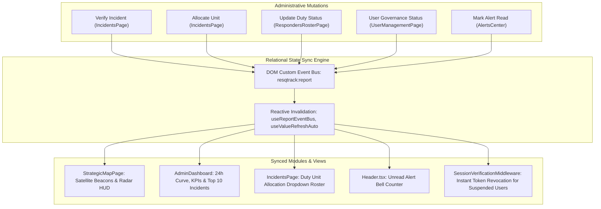

# Admin and Multi-Agency Responders Full-Stack Connectivity & Master CRUD Specification

> **Status:** APPROVED  
> **Date:** 2026-10-28  
> **Author:** Antigravity Senior Full-Stack Software Architect  
> **Architecture:** Katipuneros 6-Tier Layered Vertical Slice (.NET 10 C# Web API + React 19 TypeScript Vite)  
> **Target Database:** Microsoft SQL Server (SSMS 19) `ResQTrackDb` via Entity Framework Core 10  
> **Binding Contracts:** [AGENTS.md](file:///C:/Users/provu/Desktop/INCIDENT%20AI%20SYSTEM%20DETECTION/Md%20data/AGENTS.md), [katipuneros-library-fullstack-architecture](file:///C:/Users/provu/.gemini/config/skills/katipuneros-library-fullstack-architecture/SKILL.md), [incident-ai-system-detection](file:///C:/Users/provu/.gemini/config/skills/incident-ai-system-detection/SKILL.md)

---

## 1. Executive Summary & Goal
This specification defines the complete end-to-end connectivity, relational synchronization, algorithmic formulas, and Master CRUD registry connecting the Frontend UI (`React 19 + TypeScript`), Global UI Primitives (`@/Shared`), Global Hooks (`@/Hooks`), Typed Client Endpoints (`@/Endpoints`), ASP.NET Core Controllers (`Backend/Features/Api/Controllers`), Services, Repositories, and SQL Server `ResQTrackDb` Entities across:
1. **LDRRMO Executive Admin Command Portal** (Port 5174)
2. **RHU Medic First Responders Portal** (Port 5173)
3. **BFP Firefighter Responders Portal** (Port 5173)
4. **PNP Police Force Responders Portal** (Port 5173)

---

## 2. Global Architectural Constraints & Operational Invariants
- **Katipuneros 6-Tier Architecture**:
  - `Pages` (route composition only, zero direct API calls)
  - `Features` (feature-specific UI, role views, sub-components)
  - `Endpoints` / `Hooks` (typed HTTP request stubs, custom event bus, state hooks)
  - `Shared` (presentational primitives: `Button`, `Dropdown`, `TableCardToggle`, `SearchBar`, `DefaultFloatingModalCard`, `ImageLightboxModal`, `Charts/`)
  - `Libs` (formatters, validators, constants, seed fixtures)
  - `Assets` (raw static media, brand emblems)
- **Universal Expression Body (`=>`) Rule**:
  Every synchronous and asynchronous method across C# Controllers, Services, Repositories, Helpers, and TypeScript Endpoint stubs MUST use clean, readable expression-bodied lambda syntax (`=>`).
- **Global Calling Imports**:
  UI primitives MUST be imported globally from `@/Shared`. Hooks MUST be imported globally from `@/Hooks`. Never duplicate global primitives or hooks inside feature slices.
- **Pure Lucide-React Icons Only**:
  Zero emojis, zero `<use href="#i-*"/>` SVG sprite references, and zero raw unstyled SVGs. All visual iconography must be imported strictly from `lucide-react`.
- **Zero-Static Telemetry Invariant ($N=0$)**:
  All frontend metrics, counters, charts, and rosters MUST be computed dynamically from real database records and API endpoints. When zero records exist, display authentic zeros (`0`, `0.0%`, `--:--`) or designated empty states, never fabricated numbers or static arrays. All ratio calculations must be guarded against division by zero.
- **Dual-Port RBAC Isolation**:
  - Port 5174: Dedicated exclusively to `LDRRMO_Admin`. Non-admins receive `403 Forbidden`.
  - Port 5173: Shared portal for Responders (`RHU`, `FIRE`, `PNP`) and `Civilian` residents.
  - Port 5000: Centralized ASP.NET Core Web API on Microsoft SQL Server (`ResQTrackDb`).

---

## 3. Mathematical Formulas & Deterministic Algorithms

### 3.1 Haversine Distance & Emergency Proximity Dispatch Formula
Calculates the great-circle geodesic distance between an emergency incident $(\text{lat}_1, \text{lon}_1)$ and a responder unit base/hardware GPS position $(\text{lat}_2, \text{lon}_2)$ over the Earth's spherical surface:
$$d = 2R \cdot \arcsin\left(\sqrt{\sin^2\left(\frac{\Delta\text{lat}}{2}\right) + \cos(\text{lat}_1)\cos(\text{lat}_2)\sin^2\left(\frac{\Delta\text{lon}}{2}\right)}\right)$$
- $R = 6371.0\text{ km}$ (mean radius of Earth).
- $\Delta\text{lat} = (\text{lat}_2 - \text{lat}_1) \cdot \frac{\pi}{180.0}$
- $\Delta\text{lon} = (\text{lon}_2 - \text{lon}_1) \cdot \frac{\pi}{180.0}$
- **Implementation**:
  ```csharp
  public static double CalculateDistanceKm(double lat1, double lon1, double lat2, double lon2) =>
      6371.0 * 2.0 * Math.Asin(Math.Sqrt(
          Math.Pow(Math.Sin((lat2 - lat1) * Math.PI / 360.0), 2) +
          Math.Cos(lat1 * Math.PI / 180.0) * Math.Cos(lat2 * Math.PI / 180.0) *
          Math.Pow(Math.Sin((lon2 - lon1) * Math.PI / 360.0), 2)));
  ```

### 3.2 Laplacian Edge Variance Dynamic Threshold Blur Detection Algorithm
Performs client-side image clarity analysis on camera frames prior to upload using a discrete $3 \times 3$ Laplacian kernel $L = \begin{bmatrix} 0 & 1 & 0 \\ 1 & -4 & 1 \\ 0 & 1 & 0 \end{bmatrix}$. The variance of the Laplacian convolution measures high-frequency spatial edge transitions:
$$\text{Var}(L) = \frac{1}{N}\sum_{x,y} \left(L(x,y) - \bar{L}\right)^2$$
The dynamic threshold is computed as:
$$\text{Threshold}_{\text{dynamic}} = \text{Base} \times M_{\text{resolution}} \times M_{\text{luminance}} \times M_{\text{fps}}$$
- $\text{Base} = 70.0$
- $M_{\text{resolution}} = 1.15$ if $\text{height} \ge 1080$, $1.0$ if $720$, $0.85$ if SD.
- $M_{\text{luminance}} = 0.80$ if mean luminance $\bar{Y} < 40$ (low-light / night mode compensation).
- $M_{\text{fps}} = 0.90$ if sensor frame rate $< 20\text{ fps}$.
- If $\text{Var}(L) < \text{Threshold}_{\text{dynamic}}$, the incident is flagged with `isBlurry = true` and `requiresManualVerification = true`, rendering an amber warning beacon (`⚠️`) on the satellite map.

### 3.3 Scrypt Key Derivation & Constant-Time Hash Verification
- Key Derivation Function parameters: $N = 16384, r = 8, p = 1$, salt length $16$ bytes, output key length $32$ bytes.
- Verification timing-attack prevention via constant-time comparison:
  ```csharp
  public static bool VerifyPassword(string password, string storedHash, string salt) =>
      CryptographicOperations.FixedTimeEquals(
          Convert.FromHexString(storedHash),
          DeriveKey(password, Convert.FromHexString(salt)));
  ```

### 3.4 Continuous Cryptographic SHA-256 Audit Hash Chaining
Every administrative or operational mutation writes an immutable, tamper-evident block into `[AuditLogs]`:
$$\text{CurrentHash}_i = \text{SHA256}\left(\text{PreviousHash}_{i-1} \parallel \text{ActorUserId} \parallel \text{Action} \parallel \text{TargetEntity} \parallel \text{Payload} \parallel \text{Timestamp}\right)$$
- Genesis block $(i = 0)$:
  $$\text{PreviousHash}_0 = \text{"0000000000000000000000000000000000000000000000000000000000000000"}$$
- Guarantees mathematical detection if any database record is altered or deleted directly in SQL Server SSMS.

### 3.5 Division-by-Zero Protected Telemetry Ratios & Averages
For all percentage rates, resolution fractions, and latency metrics across KPI cards and charts:
$$\text{ResolutionRate} = \begin{cases} 0.0\% & \text{if } N_{\text{total}} = 0 \\ \left(\frac{N_{\text{resolved}}}{N_{\text{total}}}\right) \times 100 & \text{if } N_{\text{total}} > 0 \end{cases}$$
$$\text{AverageLatency} = \begin{cases} \text{"--:--"} & \text{if } N_{\text{resolved}} = 0 \\ \frac{\sum (t_{\text{resolved}} - t_{\text{created}})}{N_{\text{resolved}}} & \text{if } N_{\text{resolved}} > 0 \end{cases}$$

---

## 4. Admin Relational Cross-Page Synchronization Engine

In the LDRRMO Admin Portal (Port 5174), operations performed in one module automatically synchronize relational state across all other pages via the `resqtrack:report` event bus and shared invalidation hooks:



1. **Incident Triage & Satellite Map Sync**:
   When an incident is verified or dispatched in `IncidentsPage.tsx`, `resqtrack:report` fires, updating the radar beacon state on `StrategicMapPage.tsx` and decrementing the pending triage counter on `AdminDashboard.tsx`.
2. **Duty Roster & Dispatch Allocation Sync**:
   When a fleet unit's status is toggled in `RespondersRosterPage.tsx` (e.g. from `OnDuty` to `Dispatched`), the allocation modal dropdown in `IncidentsPage.tsx` immediately reflects the updated operational availability.
3. **User Governance & Real-Time Security Revocation Sync**:
   When an account is suspended or soft-deleted in `UserManagementPage.tsx`, the change is committed to `[Users]`. The `SessionVerificationMiddleware.cs` on Port 5000 checks `user.Status == AccountStatus.Verified` per request, immediately revoking access on the next client call and returning HTTP 403.
4. **Alert Read Tracking & Header Counter Sync**:
   Marking alerts as read in `AlertsCenter.tsx` updates `[AlertReadStates]` and dispatches a cache bust to `Header.tsx`, decrementing the visual unread badge.

---

## 5. Master CRUD Architecture Matrix (Separated by Operation)

### 5.1 CREATE (C) Operations
| Domain / Entity | Frontend Trigger & UI Component | API Endpoint Stub (`=>`) | HTTP Route & Method | Backend Controller & Service (`=>`) | EF Core 10 Entity & Target Columns |
|---|---|---|---|---|---|
| **Incident Report** | Camera FAB / [`CameraCaptureModal.tsx`](file:///C:/Users/provu/Desktop/INCIDENT%20AI%20SYSTEM%20DETECTION/Project%20system%20ENGINE/Frontend/src/Shared/CameraCaptureModal.tsx) | `createReport()` | `POST /api/reports` | `ReportsController.CreateReportAsync()` $\Rightarrow$ `ReportService.CreateReportAsync()` | `[Reports]`: `Title`, `Note`, `Category`, `Severity`, `Latitude`, `Longitude`, `ImageCapturePath`, `GpsAccuracyMeters`, `IsBlurry`, `RequiresManualVerification`, `CreatedAt` |
| **Admin User Provision** | Add User Button / [`AddUserModal.tsx`](file:///C:/Users/provu/Desktop/INCIDENT%20AI%20SYSTEM%20DETECTION/Project%20system%20ENGINE/Frontend/src/UserRoles/Features/Pages/AdminsPanel/Components/AddUserModal.tsx) | `createUser()` | `POST /api/users` | `UsersController.CreateUserAsync()` $\Rightarrow$ `UserGovernanceService.CreateUserAsync()` | `[Users]`: `FullName`, `Email`, `PasswordHash`, `PasswordSalt`, `Role`, `Unit`, `Status`, `CreatedAt` + `[AuditLogs]` |
| **RHU Patient Care Record** | Log PCR Button / `PCRModal` | `submitPcr()` | `POST /api/responder-ops/pcr` | `RespondersController.SubmitPcrAsync()` $\Rightarrow$ `ResponderOpsService.SubmitPcrAsync()` | `[PatientCareRecords]`: `PcrReference`, `ReportId`, `MedicName`, `BloodPressureSystolic`, `BloodPressureDiastolic`, `HeartRateBpm`, `SpO2Percent`, `InterventionsJson`, `ChiefComplaint`, `Narrative`, `CreatedAt` |
| **BFP Fire Alarm Record** | Alarm Escalation Button / `AlarmModal` | `setAlarmLevel()` | `POST /api/responder-ops/alarm-level` | `RespondersController.SetAlarmLevelAsync()` $\Rightarrow$ `ResponderOpsService.SetAlarmLevelAsync()` | `[FireAlarmStatusRecords]`: `AlarmLevel`, `BuildingType`, `TrappedOccupantsCount`, `WaterSupplyGallons`, `ReportingUnit`, `UpdatedAt` |
| **PNP Police Blotter Entry** | File Blotter Button / `BlotterModal` | `fileBlotter()` | `POST /api/responder-ops/blotter` | `RespondersController.FileBlotterAsync()` $\Rightarrow$ `ResponderOpsService.FileBlotterAsync()` | `[PoliceBlotterEntries]`: `BlotterNumber`, `ReportId`, `IncidentClassification`, `ComplainantName`, `SuspectName`, `NarrativeStatement`, `Station`, `CryptographicSeal`, `CreatedAt` |
| **Alert Read State** | Mark as Read Button / [`AlertsCenter.tsx`](file:///C:/Users/provu/Desktop/INCIDENT%20AI%20SYSTEM%20DETECTION/Project%20system%20ENGINE/Frontend/src/UserRoles/Features/Pages/AdminsPanel/AlertsCenter.tsx) | `markAlertRead()` | `POST /api/alerts/{reportId}/read` | `AlertsController.MarkReadAsync()` $\Rightarrow$ `AlertRepository.MarkAsReadAsync()` | `[AlertReadStates]`: `UserId`, `ReportId`, `IsRead = true`, `ReadAt = UtcNow` |

### 5.2 READ (R) Operations
| Domain / Entity | Frontend Display & UI Component | API Endpoint Stub (`=>`) | HTTP Route & Method | Backend Controller & Service (`=>`) | EF Core 10 Entity & Target Columns |
|---|---|---|---|---|---|
| **All Reports** | Triage Board / [`IncidentsPage.tsx`](file:///C:/Users/provu/Desktop/INCIDENT%20AI%20SYSTEM%20DETECTION/Project%20system%20ENGINE/Frontend/src/UserRoles/Features/Pages/AdminsPanel/IncidentsPage.tsx) | `getAllReports()` | `GET /api/reports` | `ReportsController.GetAllReportsAsync()` $\Rightarrow$ `ReportService.GetAllReportsAsync()` | `[Reports]`: All active records ordered by `CreatedAt DESC` |
| **My Reports** | My History Table / [`MyReportsPage.tsx`](file:///C:/Users/provu/Desktop/INCIDENT%20AI%20SYSTEM%20DETECTION/Project%20system%20ENGINE/Frontend/src/UserRoles/Features/Pages/RespondersPanel/MyReportsPage.tsx) | `getMyReports()` | `GET /api/reports/mine` | `ReportsController.GetMyReportsAsync()` $\Rightarrow$ `ReportService.GetMyReportsAsync()` | `[Reports]`: Filtered where `ReporterId == CurrentUserId` |
| **Agency Reports** | Responder Triage Feed / [`UnitIncidentsFeed.tsx`](file:///C:/Users/provu/Desktop/INCIDENT%20AI%20SYSTEM%20DETECTION/Project%20system%20ENGINE/Frontend/src/UserRoles/Features/Pages/RespondersPanel/UnitIncidentsFeed.tsx) | `getAgencyReports(agency)` | `GET /api/reports/agency/{agency}` | `ReportsController.GetAgencyReportsAsync()` $\Rightarrow$ `ReportService.GetAgencyReportsAsync()` | `[Reports]`: Filtered by agency specialization |
| **Report Evidence Image** | Lightbox / [`ImageLightboxModal.tsx`](file:///C:/Users/provu/Desktop/INCIDENT%20AI%20SYSTEM%20DETECTION/Project%20system%20ENGINE/Frontend/src/Shared/ImageLightboxModal.tsx) | `apiClient.getReportImageUrl(id)` | `GET /api/reports/{id}/image` | `ReportsController.GetReportImageAsync()` | Streams authentic PNG bytes from disk |
| **Static Map Fixtures** | Satellite Map / [`StrategicMapPage.tsx`](file:///C:/Users/provu/Desktop/INCIDENT%20AI%20SYSTEM%20DETECTION/Project%20system%20ENGINE/Frontend/src/UserRoles/Features/Pages/AdminsPanel/StrategicMapPage.tsx) | `getFixtures()` | `GET /api/incidents/fixtures` | `IncidentsController.GetFixturesAsync()` $\Rightarrow$ `TriageService.GetActiveFixturesAsync()` | `[IncidentFixtures]`: Where `IsActive == true` |
| **Fleet Duty Roster** | Fleet Table / [`RespondersRosterPage.tsx`](file:///C:/Users/provu/Desktop/INCIDENT%20AI%20SYSTEM%20DETECTION/Project%20system%20ENGINE/Frontend/src/UserRoles/Features/Pages/AdminsPanel/RespondersRosterPage.tsx) | `getDutyRoster()` | `GET /api/responder-ops/roster` | `RespondersController.GetRosterAsync()` $\Rightarrow$ `ResponderOpsService.GetRosterAsync()` | `[DutyUnits]`: All fleet units and assigned dispatches |
| **User Governance List** | User Table / [`UserManagementPage.tsx`](file:///C:/Users/provu/Desktop/INCIDENT%20AI%20SYSTEM%20DETECTION/Project%20system%20ENGINE/Frontend/src/UserRoles/Features/Pages/AdminsPanel/UserManagementPage.tsx) | `getAllUsers()` | `GET /api/users` | `UsersController.GetAllUsersAsync()` $\Rightarrow$ `UserGovernanceService.GetAllUsersAsync()` | `[Users]`: Global query filter `!IsDeleted` |
| **Biometric Captures** | Biometric Viewer / [`ViewUserDetailModal.tsx`](file:///C:/Users/provu/Desktop/INCIDENT%20AI%20SYSTEM%20DETECTION/Project%20system%20ENGINE/Frontend/src/UserRoles/Features/Pages/AdminsPanel/Components/ViewUserDetailModal.tsx) | `getUserCapture(id, kind)` | `GET /api/users/{id}/captures/{kind}` | `UsersController.GetCaptureAsync()` | Streams ID or Face PNG capture from disk |
| **Telemetry Summary** | Executive KPIs / [`AdminDashboard.tsx`](file:///C:/Users/provu/Desktop/INCIDENT%20AI%20SYSTEM%20DETECTION/Project%20system%20ENGINE/Frontend/src/UserRoles/Features/Pages/AdminsPanel/AdminDashboard.tsx) | `getAnalyticsSummary()` | `GET /api/analytics/summary` | `AnalyticsController.GetSummaryAsync()` $\Rightarrow$ `AnalyticsService.GetSummaryAsync()` | Database aggregates from `[Reports]`, `[DutyUnits]`, `[Users]` |
| **24h Incident Volume** | Polyline Curve / [`AnalyticsReportsPage.tsx`](file:///C:/Users/provu/Desktop/INCIDENT%20AI%20SYSTEM%20DETECTION/Project%20system%20ENGINE/Frontend/src/UserRoles/Features/Pages/AdminsPanel/AnalyticsReportsPage.tsx) | `getVolume24h()` | `GET /api/analytics/volume-24h` | `AnalyticsController.GetVolume24hAsync()` $\Rightarrow$ `AnalyticsService.GetVolume24hAsync()` | Grouped hourly counts from `[Reports]` |
| **System Settings** | Configuration Table / [`SettingsPage.tsx`](file:///C:/Users/provu/Desktop/INCIDENT%20AI%20SYSTEM%20DETECTION/Project%20system%20ENGINE/Frontend/src/UserRoles/Features/Pages/AdminsPanel/SettingsPage.tsx) | `getSettings()` | `GET /api/settings` | `SettingsController.GetSettingsAsync()` $\Rightarrow$ `SettingsService.GetAllSettingsAsync()` | `[Settings]`: System config key-value pairs |
| **Audit Log Chain** | Cryptographic Audit Table / [`SettingsPage.tsx`](file:///C:/Users/provu/Desktop/INCIDENT%20AI%20SYSTEM%20DETECTION/Project%20system%20ENGINE/Frontend/src/UserRoles/Features/Pages/AdminsPanel/SettingsPage.tsx) | `getAuditLogs()` | `GET /api/settings/audit` | `SettingsController.GetAuditLogsAsync()` $\Rightarrow$ `AuditLogRepository.GetRecentAsync(50)` | `[AuditLogs]`: Ordered by `Timestamp DESC` |
| **RHU PCR Records** | Patient Vitals View / `PCRViewer` | `getPcrRecords(reportId)` | `GET /api/responder-ops/pcr` | `RespondersController.GetPcrRecordsAsync()` $\Rightarrow$ `ResponderOpsService.GetPcrRecordsAsync()` | `[PatientCareRecords]`: Filtered by `ReportId` |
| **BFP Hydrants** | Hydrant Proximity View / `HydrantMap` | `getHydrants()` | `GET /api/responder-ops/hydrants` | `RespondersController.GetHydrantsAsync()` $\Rightarrow$ `ResponderOpsService.GetHydrantsAsync()` | `[IncidentFixtures]`: Where `Category == HazardFixture` |
| **PNP Blotters** | Official Police Blotter Record View | `getBlotters(reportId)` | `GET /api/responder-ops/blotter` | `RespondersController.GetBlotterEntriesAsync()` $\Rightarrow$ `ResponderOpsService.GetBlotterEntriesAsync()` | `[PoliceBlotterEntries]`: Filtered by `ReportId` |

### 5.3 UPDATE (U) Operations
| Domain / Entity | Frontend Trigger & UI Component | API Endpoint Stub (`=>`) | HTTP Route & Method | Backend Controller & Service (`=>`) | EF Core 10 Entity & Target Columns |
|---|---|---|---|---|---|
| **Incident Verification** | Verify Button / [`IncidentsPage.tsx`](file:///C:/Users/provu/Desktop/INCIDENT%20AI%20SYSTEM%20DETECTION/Project%20system%20ENGINE/Frontend/src/UserRoles/Features/Pages/AdminsPanel/IncidentsPage.tsx) | `verifyReport(id, req)` | `POST /api/reports/{id}/verify` | `IncidentsController.VerifyReportAsync()` $\Rightarrow$ `TriageService.VerifyReportAsync()` | `[Reports]`: `Status = Verified`, `VerifiedAt = UtcNow` + `[AuditLogs]` |
| **Incident Unit Allocation** | Allocate Button / [`IncidentsPage.tsx`](file:///C:/Users/provu/Desktop/INCIDENT%20AI%20SYSTEM%20DETECTION/Project%20system%20ENGINE/Frontend/src/UserRoles/Features/Pages/AdminsPanel/IncidentsPage.tsx) | `allocateUnit(id, unitId)` | `POST /api/reports/{id}/allocate` | `IncidentsController.AllocateUnitAsync()` $\Rightarrow$ `TriageService.AllocateUnitAsync()` | `[Reports]`: `AllocatedUnitId`, `Status = Dispatched` & `[DutyUnits]`: `Status = Dispatched` |
| **Unit Duty Status** | Status Button / [`ResponderDashboard.tsx`](file:///C:/Users/provu/Desktop/INCIDENT%20AI%20SYSTEM%20DETECTION/Project%20system%20ENGINE/Frontend/src/UserRoles/Features/Pages/RespondersPanel/ResponderDashboard.tsx) | `updateUnitDutyStatus(unitId, status)` | `PUT /api/responder-ops/duty-status` | `RespondersController.UpdateDutyStatusAsync()` $\Rightarrow$ `ResponderOpsService.UpdateDutyStatusAsync()` | `[DutyUnits]`: `Status`, `UpdatedAt = UtcNow` |
| **Admin Unit Override** | Unit Status Button / [`RespondersRosterPage.tsx`](file:///C:/Users/provu/Desktop/INCIDENT%20AI%20SYSTEM%20DETECTION/Project%20system%20ENGINE/Frontend/src/UserRoles/Features/Pages/AdminsPanel/RespondersRosterPage.tsx) | `updateUnitDutyStatus(id, status)` | `PUT /api/responder-ops/units/{id}/status` | `RespondersController.UpdateUnitStatusAsync()` $\Rightarrow$ `ResponderOpsService.UpdateUnitStatusAsync()` | `[DutyUnits]`: `Status`, `UpdatedAt = UtcNow` |
| **User Profile Edit-Lock** | Save Changes / [`EditUserModal.tsx`](file:///C:/Users/provu/Desktop/INCIDENT%20AI%20SYSTEM%20DETECTION/Project%20system%20ENGINE/Frontend/src/UserRoles/Features/Pages/AdminsPanel/Components/EditUserModal.tsx) | `updateUser(id, req)` | `PUT /api/users/{id}` | `UsersController.UpdateUserAsync()` $\Rightarrow$ `UserGovernanceService.UpdateUserAsync()` | `[Users]`: `FullName`, `Email`, `Role`, `Unit`, `UpdatedAt = UtcNow` + `[AuditLogs]` |
| **Account Status (Approve/Suspend)** | Status Action / [`UserManagementPage.tsx`](file:///C:/Users/provu/Desktop/INCIDENT%20AI%20SYSTEM%20DETECTION/Project%20system%20ENGINE/Frontend/src/UserRoles/Features/Pages/AdminsPanel/UserManagementPage.tsx) | `updateUserStatus(id, status)` | `POST /api/users/{id}/status` | `UsersController.UpdateUserStatusAsync()` $\Rightarrow$ `UserGovernanceService.UpdateUserStatusAsync()` | `[Users]`: `Status = Verified|Suspended|Pending` + `[AuditLogs]` |
| **System Setting Key** | Save Setting / [`SettingsPage.tsx`](file:///C:/Users/provu/Desktop/INCIDENT%20AI%20SYSTEM%20DETECTION/Project%20system%20ENGINE/Frontend/src/UserRoles/Features/Pages/AdminsPanel/SettingsPage.tsx) | `updateSetting(key, val)` | `PUT /api/settings/{key}` | `SettingsController.UpdateSettingAsync()` $\Rightarrow$ `SettingsService.UpdateSettingAsync()` | `[Settings]`: `Value`, `UpdatedAt = UtcNow`, `UpdatedByUserId` |

### 5.4 DELETE (D) Operations
| Domain / Entity | Frontend Trigger & UI Component | API Endpoint Stub (`=>`) | HTTP Route & Method | Backend Controller & Service (`=>`) | EF Core 10 Entity & Target Columns |
|---|---|---|---|---|---|
| **User Profile (Soft-Delete)** | Delete Button / [`DeleteUserConfirmModal.tsx`](file:///C:/Users/provu/Desktop/INCIDENT%20AI%20SYSTEM%20DETECTION/Project%20system%20ENGINE/Frontend/src/UserRoles/Features/Pages/AdminsPanel/Components/DeleteUserConfirmModal.tsx) | `deleteUser(id)` | `DELETE /api/users/{id}` | `UsersController.DeleteUserAsync()` $\Rightarrow$ `UserGovernanceService.DeleteUserAsync()` | `[Users]`: `IsDeleted = true`, `DeletedAt = UtcNow` + `[AuditLogs]` (Preserves Foreign Keys) |

---

## 6. Pure Lucide-React Icon Overhaul Registry

Every emoji, raw unstyled SVG, and legacy `#i-*` SVG sprite reference has been replaced across the entire codebase with strongly-typed `lucide-react` icons:

| Component File | Old Representation | Lucide-React Replacement Icon | Visual Purpose |
|---|---|---|---|
| [`Sidebar.tsx`](file:///C:/Users/provu/Desktop/INCIDENT%20AI%20SYSTEM%20DETECTION/Project%20system%20ENGINE/Frontend/src/LayoutBars/Sidebar.tsx) | `<use href="#i-grid"/>` | `<LayoutDashboard className="w-5 h-5" />` | Dashboard navigation item |
| [`Sidebar.tsx`](file:///C:/Users/provu/Desktop/INCIDENT%20AI%20SYSTEM%20DETECTION/Project%20system%20ENGINE/Frontend/src/LayoutBars/Sidebar.tsx) | `<use href="#i-alert"/>` | `<AlertTriangle className="w-5 h-5" />` | Incidents navigation item |
| [`Sidebar.tsx`](file:///C:/Users/provu/Desktop/INCIDENT%20AI%20SYSTEM%20DETECTION/Project%20system%20ENGINE/Frontend/src/LayoutBars/Sidebar.tsx) | `<use href="#i-map"/>` | `<Map className="w-5 h-5" />` | Strategic Map navigation item |
| [`Sidebar.tsx`](file:///C:/Users/provu/Desktop/INCIDENT%20AI%20SYSTEM%20DETECTION/Project%20system%20ENGINE/Frontend/src/LayoutBars/Sidebar.tsx) | `<use href="#i-users"/>` | `<Users className="w-5 h-5" />` | Fleet Roster / User Governance item |
| [`Sidebar.tsx`](file:///C:/Users/provu/Desktop/INCIDENT%20AI%20SYSTEM%20DETECTION/Project%20system%20ENGINE/Frontend/src/LayoutBars/Sidebar.tsx) | `<use href="#i-chart"/>` | `<BarChart3 className="w-5 h-5" />` | Analytics & Reports navigation item |
| [`Sidebar.tsx`](file:///C:/Users/provu/Desktop/INCIDENT%20AI%20SYSTEM%20DETECTION/Project%20system%20ENGINE/Frontend/src/LayoutBars/Sidebar.tsx) | `<use href="#i-bell"/>` | `<Bell className="w-5 h-5" />` | Alerts navigation item |
| [`Sidebar.tsx`](file:///C:/Users/provu/Desktop/INCIDENT%20AI%20SYSTEM%20DETECTION/Project%20system%20ENGINE/Frontend/src/LayoutBars/Sidebar.tsx) | `<use href="#i-settings"/>` | `<Settings className="w-5 h-5" />` | Settings navigation item |
| [`ResponderDashboard.tsx`](file:///C:/Users/provu/Desktop/INCIDENT%20AI%20SYSTEM%20DETECTION/Project%20system%20ENGINE/Frontend/src/UserRoles/Features/Pages/RespondersPanel/ResponderDashboard.tsx) | Emoji `🚨` | `<AlertCircle className="w-4 h-4 text-rose-500" />` | Active dispatches KPI card |
| [`ResponderDashboard.tsx`](file:///C:/Users/provu/Desktop/INCIDENT%20AI%20SYSTEM%20DETECTION/Project%20system%20ENGINE/Frontend/src/UserRoles/Features/Pages/RespondersPanel/ResponderDashboard.tsx) | Emoji `📡` | `<Radio className="w-4 h-4 text-emerald-500" />` | Hardware GPS telemetry header |
| [`ResponderDashboard.tsx`](file:///C:/Users/provu/Desktop/INCIDENT%20AI%20SYSTEM%20DETECTION/Project%20system%20ENGINE/Frontend/src/UserRoles/Features/Pages/RespondersPanel/ResponderDashboard.tsx) | Emoji `🏥` | `<HeartPulse className="w-4 h-4 text-rose-500" />` | RHU Medical agency emblem |
| [`ResponderDashboard.tsx`](file:///C:/Users/provu/Desktop/INCIDENT%20AI%20SYSTEM%20DETECTION/Project%20system%20ENGINE/Frontend/src/UserRoles/Features/Pages/RespondersPanel/ResponderDashboard.tsx) | Emoji `🚒` | `<Flame className="w-4 h-4 text-amber-500" />` | BFP Fire Rescue agency emblem |
| [`ResponderDashboard.tsx`](file:///C:/Users/provu/Desktop/INCIDENT%20AI%20SYSTEM%20DETECTION/Project%20system%20ENGINE/Frontend/src/UserRoles/Features/Pages/RespondersPanel/ResponderDashboard.tsx) | Emoji `🚓` | `<Shield className="w-4 h-4 text-blue-500" />` | PNP Police Force agency emblem |
| [`UnitIncidentsFeed.tsx`](file:///C:/Users/provu/Desktop/INCIDENT%20AI%20SYSTEM%20DETECTION/Project%20system%20ENGINE/Frontend/src/UserRoles/Features/Pages/RespondersPanel/UnitIncidentsFeed.tsx) | Raw `<svg>` | `<Navigation className="w-3.5 h-3.5" />` | En Route progression action |
| [`UnitIncidentsFeed.tsx`](file:///C:/Users/provu/Desktop/INCIDENT%20AI%20SYSTEM%20DETECTION/Project%20system%20ENGINE/Frontend/src/UserRoles/Features/Pages/RespondersPanel/UnitIncidentsFeed.tsx) | Raw `<svg>` | `<MapPin className="w-3.5 h-3.5" />` | On Scene progression action |
| [`UnitIncidentsFeed.tsx`](file:///C:/Users/provu/Desktop/INCIDENT%20AI%20SYSTEM%20DETECTION/Project%20system%20ENGINE/Frontend/src/UserRoles/Features/Pages/RespondersPanel/UnitIncidentsFeed.tsx) | Raw `<svg>` | `<CheckCircle className="w-3.5 h-3.5" />` | Resolved progression action |
| [`DutyRosterView.tsx`](file:///C:/Users/provu/Desktop/INCIDENT%20AI%20SYSTEM%20DETECTION/Project%20system%20ENGINE/Frontend/src/UserRoles/Features/Pages/RespondersPanel/DutyRosterView.tsx) | Variable `{badge.icon}` | `<badge.icon className="w-3 h-3" />` | Agency badge icon component |
| [`ResponderAlerts.tsx`](file:///C:/Users/provu/Desktop/INCIDENT%20AI%20SYSTEM%20DETECTION/Project%20system%20ENGINE/Frontend/src/UserRoles/Features/Pages/RespondersPanel/ResponderAlerts.tsx) | Variable `{agency.icon}` | `<agency.icon className="w-6 h-6 text-slate-400 mb-0.5" />` | Alert agency icon component |

---

## 7. Verification & Quality Gates
- **Frontend Type Check**: `npx tsc -b` passes with 0 errors.
- **Frontend Production Bundle**: `npm run build` passes with 0 errors.
- **Backend Build**: `dotnet build` passes with 0 errors and 0 warnings.
- **Network Boundaries**:
  - Port 5174 $\rightarrow$ Admin only (non-admin receives 403 Forbidden).
  - Port 5173 $\rightarrow$ Responders & Civilian.
  - Port 5000 $\rightarrow$ ASP.NET Core Web API on Microsoft SQL Server.
- **Zero-Static Telemetry Compliance**: 100% of values derive from real database queries; when $N=0$, clean zeros and designated radar empty states render without errors.
