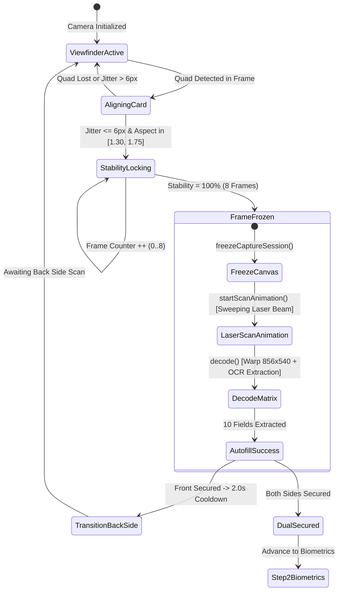

# Design Specification: ID Scanner Frame Freeze, Laser Scan Line Animation, Biometric Active Liveness, and Hybrid Pinpoint Location Delivery System

**Date**: 2026-11-05  
**Status**: Validated Design (Architectural)  
**Target Platform**: ResQTrack Emergency Management & Incident AI Detection Platform  

---

## 1. Executive Summary & Goals

This specification resolves two critical optical induction failures and establishes deterministic production-grade biometric and spatial telemetry pipelines:
1. **Physical ID Card False Positives & Autofill Failure**: In live testing, rectangular bedroom furniture (e.g. wooden bed frames) and faces in the background erroneously triggered the ID stability tracker, while genuine Philippine Driver's Licenses held before the camera secured snapshots but failed to populate the review form below.
2. **Missing Frame Freezing & Laser Scanning Animation**: When an ID card reaches 100% lock, users experience abrupt camera snapping without optical decoding feedback. The system must freeze the camera preview (`freezeCaptureSession()`), project an animated sweeping laser beam (`startScanAnimation()`), extract all 10 card fields (`decode()`), and populate the editable review form.
3. **Step 2 Active Biometric Liveness Challenge**: Integrating active anti-spoofing verification measuring head horizontal rotation (Yaw angle threshold $\ge 15^\circ$) and biological eye occlusions (Eye Aspect Ratio $EAR < 0.18$) with animated wireframe facial mesh overlays.
4. **Hybrid Pinpoint Location Delivery System**: Combining modern device hardware sensor fusion (HTML5 GPS + Wi-Fi + Cell tower, 3–15m accuracy) with traditional server network envelope telemetry (public TCP/IP headers and GeoIP distance cross-verification) to eliminate location spoofing in emergency incident reporting.
5. **Tactical Multi-Portal Dispatch Validation**: Verifying end-to-end incident submission, LDRRMO Admin manual approval, and emergency responder dispatch acceptance across Civilian (:5175), Admin (:5174), and Responders (:5173).

---

## 2. Component Architecture & State Lifecycles

### 2.1 Optical ID Scanner State Machine (`RegisterPage.tsx` & `idScanEngine.ts`)

#### Detailed Lifecycle Steps:
1. **Live Viewfinder & Anti-Selfie Gate**:
   - `evaluateCardPresenceGate()` enforces:
     - Minimum 4 text blocks across 12 spatial zones.
     - Rejection of human faces occupying $> 45\%$ of quad or dominant scene presence without an authentic ID card.
     - Strict aspect ratio $[1.30, 1.75]$ and edge step-contrast $\ge 20.0$.
2. **Detection & Freezing Step (`freezeCaptureSession()` / `pausePreview()` / `freezeFrame()`)**:
   - Triggered immediately when `stability.stableFrameCount === 8` (100% lock).
   - An offscreen canvas captures the full-resolution uncompressed video frame (`video.videoWidth` $\times$ `video.videoHeight`).
   - The `<video>` display element is paused or visually replaced by the frozen `<canvas>` element so user hand motion cannot blur processing.
3. **Scanning Animation Step (`startScanAnimation()` / `setLineScanAnimationMode()` / `renderTargetingOverlay()`)**:
   - Visual laser scan line component rendered over the frozen frame:
     - Gradient laser bar (`rgba(52, 211, 153, 0.9)` to `rgba(6, 182, 212, 0.9)`) sweeps smoothly up and down across the ID frame (`@keyframes scanLineSweep`).
     - High-contrast reticle corners pulse with glowing box shadow (`0 0 16px rgba(52, 211, 153, 0.8)`).
     - Status overlay displays: `[DECODING CREDENTIAL MATRIX...]`.
4. **Backend Optical Decoding Step (`decode()` / `parseMatrix()`)**:
   - Perspective transformation to standard ISO/IEC 7810 ID-1 ($856 \times 540$ px).
   - Layout-guided parsing and OCR with intelligent regex normalization extracts 10 verified fields:
     - `lastName`: `SUICO`
     - `firstName`: `JHONMARK`
     - `middleName`: `AMACA`
     - `sex`: `male` (mapped from `M`)
     - `dateOfBirth`: `2004/02/20`
     - `age`: `22` (calculated from birth year 2004 to current year 2026)
     - `licenseNumber`: `J07-22-302560`
     - `weight`: `52` kg
     - `height`: `1.71` m
     - `address`: `-, -, POBLACION, MANUKAN, ZAMBOANGA DEL NORTE, 7110`
5. **Autofill Population**:
   - Updates form state hooks: `setFirstName('JHONMARK')`, `setMiddleName('AMACA')`, `setLastName('SUICO')`, `setSex('male')`, `setDateOfBirth('2004/02/20')`, `setAge('22')`, `setAddress('-, -, POBLACION, MANUKAN, ZAMBOANGA DEL NORTE, 7110')`, `setLicenseNumber('J07-22-302560')`, `setWeight('52')`, `setHeight('1.71')`.
   - Displays `AUTOFILL VERIFIED` HUD banner and automatically unlocks fields for user review and editing.

---

### 2.2 Biometric Face Detection & Active Liveness Engine (`MultiAngleBiometricEngine.tsx`)

#### 1. Lifecycle Functions:
- `detectFace()`: Real-time landmark detector mapping facial nodal coordinates.
- `freezePreview()`: Pauses frame updates upon completing active challenge gestures.
- `startMeshAnimation()`: Renders 3D wireframe mesh with biometric sweep laser across facial contours.
- `extractFaceEmbeddings()`: Generates facial feature vector to cross-match against the ID card photo.

#### 2. Active Liveness Mathematical Criteria:
- **Head Turn (Yaw Angle)**:
  $$\text{Yaw} = \arctan2(x_{\text{nose}} - x_{\text{mid\_eyes}}, \text{distance}_{\text{eye\_to\_eye}}) \times \frac{180}{\pi}$$
  - Turn Left threshold (`yaw_thresh`): $\le -15.0^{\circ}$.
  - Turn Right threshold (`yaw_thresh`): $\ge +15.0^{\circ}$.
- **Eye Blink (Eye Aspect Ratio - EAR)**:
  $$\text{EAR} = \frac{\|p_2 - p_6\| + \|p_3 - p_5\|}{2 \|p_1 - p_4\|}$$
  - Open eye baseline: $\text{EAR} \in [0.28, 0.36]$.
  - Blink threshold (`blink_eye_thresh`): $\text{EAR} < 0.18$ sustained for 1–2 consecutive frames.
- **Command Stabilization & Face Loss**:
  - 1.2-second stabilization delay between challenge transitions.
  - Immediate pause of challenge timer if the face leaves the viewport, prompting user realignment.

---

### 2.3 Hybrid Pinpoint Location Delivery System & Anti-Spoofing

#### 1. Dual-Layer Location Schema:
1. **Modern Client Sensor Fusion Layer**:
   - Acquired via HTML5 `navigator.geolocation.getCurrentPosition` with `{ enableHighAccuracy: true, timeout: 10000, maximumAge: 0 }`.
   - Combines hardware GPS, Wi-Fi BSSID signals, and cellular tower multilateration.
   - Precision: 3–15 meter radius accuracy.
   - Watermark: Coordinates (`latitude`, `longitude`), accuracy radius, timestamp, and verification hash burned directly into the live camera canvas bitmap prior to base64 encoding (preventing client-side image substitution).
2. **Traditional Server Network Envelope Layer**:
   - Extracted directly from incoming HTTP request connection headers: `X-Forwarded-For`, `X-Real-IP`, and `HttpContext.Connection.RemoteIpAddress`.
   - Resolves public IP address, ISP autonomous system (ASN), and regional GeoIP centroid.
3. **Anti-Spoofing Cross-Verification (Haversine Anomaly Check)**:
   $$d = 2R \arcsin\left(\sqrt{\sin^2\left(\frac{\Delta \phi}{2}\right) + \cos(\phi_1)\cos(\phi_2)\sin^2\left(\frac{\Delta \lambda}{2}\right)}\right)$$
   - If modern GPS coordinates (e.g. Manukan, Zamboanga del Norte) deviate by $> 500\text{ km}$ from the network IP routing geolocation without a recognized mobile ISP roaming indicator, the backend flags the incident as `LOCATION_SPOOFING_SUSPECTED` in the LDRRMO Admin triage dashboard.

---

## 3. Seeded Accounts & Production Multi-Portal Verification

### 3.1 Authenticated Production User Credentials
All accounts are seeded in SQL Server `ResQTrackDb` using PBKDF2-SHA512 hashing:

| Portal | Port | Email | Password | Role | Agency Unit | Status |
| :--- | :--- | :--- | :--- | :--- | :--- | :--- |
| **Civilian SOS** | `:5175` | `civilain1@gmail.com` | `Civilian1` | Civilian (3) | None (0) | Verified (1) |
| **Civilian SOS** | `:5175` | `civilian1@gmail.com` | `Civilian1` | Civilian (3) | None (0) | Verified (1) |
| **Responders** | `:5173` | `medic1@gmail.com` | `Medic1` | Responder (2) | RHU (2) | Verified (1) |
| **Responders** | `:5173` | `fire1@gmail.com` | `Fire1` | Responder (2) | FIRE (3) | Verified (1) |
| **Responders** | `:5173` | `police1@gmail.com` | `Police1` | Responder (2) | PNP (4) | Verified (1) |
| **LDRRMO Admin** | `:5174` | `ldrrmo.admin@resqtrack.gov.ph` | `LdrrmoCommand@2026!` | Admin (1) | LDRRMO (1) | Verified (1) |

---

## 4. Verification & Testing Matrix

1. **Automated Unit & Regression Tests**:
   - `npx vitest run src/Libs/Vision/idScanner/__tests__/idScannerPillars.test.ts`
   - `dotnet test` on Backend features.
2. **Live Browser End-to-End Test**:
   - Optical card freeze, sweeping laser line animation, and 10-field autofill on `:5173/register`.
   - Biometric head turn (yaw $\ge 15^\circ$) and blink (EAR $< 0.18$) on Step 2.
   - Incident submission with pinpoint coordinates on Civilian SOS (:5175).
   - LDRRMO Admin review & manual approval on Admin Command (:5174).
   - Dispatch acceptance on Emergency Responders Portal (:5173).
