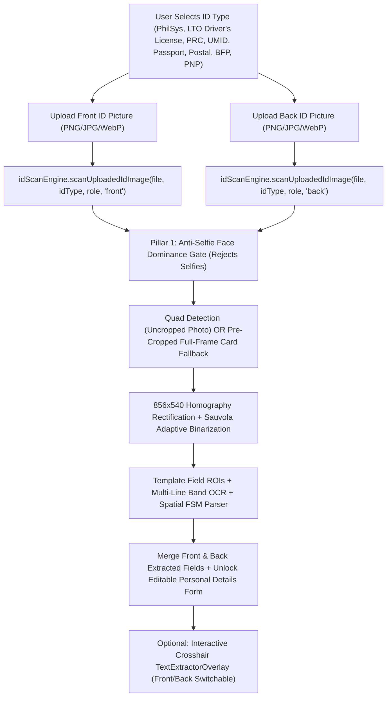

# Recreated Phase 1 Registration: Upload-Only Front & Back Government ID with Automated On-Device Text Extraction

**Date:** 2026-11-08  
**Project:** ResQTrack — Incident AI System Detection  
**Scope:** Registration Step 1 (`01 Identity`), `idScanEngine.ts`, `idScanWorker.ts`, `TextExtractorOverlay.tsx`

---

## 1. Architectural Overview

Phase 1 (`01 Identity`) of the ResQTrack Registration Wizard is redesigned to **eliminate live camera ID detection** and operate exclusively through **Front & Back Government ID Picture Uploads** paired with **Automated On-Device Optical Character Recognition (OCR)** and the **Interactive Crosshair Text Extractor Overlay**.

Wait-free, deterministic image processing executes immediately when the user uploads or drops their Front ID and Back ID images, while Phase 2 (`02 Biometrics`) retains its independent live camera stream (`MultiAngleBiometricEngine.tsx`) for 4-angle active facial liveness and 1:1 portrait verification against the uploaded Front ID portrait crop.

---

## 2. Inventory of Files & Code Changes (Edit, Remove/Delete, Add)

### 2.1 Files to be REMOVED / DELETED
1. [`Project system ENGINE/Frontend/src/LANDING_PAGE/Features/Pages/Register/Register.tsx`](file:///C:/Users/provu/Desktop/INCIDENT%20AI%20SYSTEM%20DETECTION/Project%20system%20ENGINE/Frontend/src/LANDING_PAGE/Features/Pages/Register/Register.tsx) — Obsolete, unmounted legacy 3-step registration component that used live camera modal capture for IDs.
2. [`Project system ENGINE/Frontend/src/Libs/Vision/idScanner/__tests__/verify_id_freeze_and_retake_lifecycle.ts`](file:///C:/Users/provu/Desktop/INCIDENT%20AI%20SYSTEM%20DETECTION/Project%20system%20ENGINE/Frontend/src/Libs/Vision/idScanner/__tests__/verify_id_freeze_and_retake_lifecycle.ts) — Legacy live-stream temporal stability & freeze-frame test suite (replaced by `verify_uploaded_id_ocr_pipeline.ts`).

### 2.2 Files & Code Blocks to be EDITED
1. [`Project system ENGINE/Frontend/src/Libs/Vision/idScanner/idScanWorker.ts`](file:///C:/Users/provu/Desktop/INCIDENT%20AI%20SYSTEM%20DETECTION/Project%20system%20ENGINE/Frontend/src/Libs/Vision/idScanner/idScanWorker.ts):
   - **Remove**: `WorkerAnalyzeFrameRequest`, `WorkerAnalyzeFrameResponse`, and `executeFrameAnalysis` (live video stream frame-loop).
   - **Edit / Add**:
     - Add `side?: 'front' | 'back'` and `isStaticUpload?: boolean` to `WorkerFullScanRequest` and `executeFullCardScan`.
     - Add **Pre-Cropped / Full-Frame Uploaded ID Fallback**: when an uploaded ID image is already tightly cropped to the card boundaries (`findCardQuad` returns `null`), verify that `cardPresence.status !== 'FACE_DETECTED'` and that document interior text density passes, then rectify the full image frame to canonical `856 x 540`.
     - Support `side === 'back'` by scanning `spec.reverseFields` plus full-card multi-line OCR (`extractTextFromRoi` + `parseIdFieldsWithSpatialFsm`), and validate back-side geometry without requiring front-only header fields.
     - Extract `portraitImageData` from `spec.photoRoi` on `side === 'front'`.
2. [`Project system ENGINE/Frontend/src/Libs/Vision/idScanner/idScanEngine.ts`](file:///C:/Users/provu/Desktop/INCIDENT%20AI%20SYSTEM%20DETECTION/Project%20system%20ENGINE/Frontend/src/Libs/Vision/idScanner/idScanEngine.ts):
   - **Remove**: `TemporalStabilityTracker`, `SmartCaptureRingBuffer`, `FrameAnalysisResult`, `startLiveStream`, `stopLiveStream`, `resetStability`, `analyzeFrame`, and live video loop state.
   - **Edit / Add**:
     - Add `scanUploadedIdImage(source, targetCategory, userRole, side)` that accepts `File | Blob | string | HTMLImageElement | ImageData`, normalizes resolution/orientation, runs `scanCard`, and extracts `portraitImageUrl`.
     - Add `mergeFrontAndBackFields(frontFields, backFields)` to deterministically combine Front ID fields with supplemental Back ID fields.
3. [`Project system ENGINE/Frontend/src/LANDING_PAGE/Features/Pages/RegisterPage/RegisterPage.tsx`](file:///C:/Users/provu/Desktop/INCIDENT%20AI%20SYSTEM%20DETECTION/Project%20system%20ENGINE/Frontend/src/LANDING_PAGE/Features/Pages/RegisterPage/RegisterPage.tsx):
   - **Remove**: `idCaptureMode`, `isFlippingCard`, `flipCooldownTimerRef`, `isCameraActive`, `cameraError`, `isFrameFrozen`, `frozenFrameUrl`, `isFrameFrozenRef`, `frozenFrameUrlRef`, `scannerAnalysis`, `videoRef`, `videoStreamRef`, `generateSyntheticIdCanvas`, `startCamera`, `stopCamera`, `freezeCaptureSession`, `startScanAnimation`, `decode`, `captureFromVideoOrSynthetic`, `handleCaptureCurrentStage`, `handleRetakeFront`, and the `idCaptureMode === 'camera'` live viewfinder JSX block.
   - **Edit / Add**:
     - Add `isScanningFront`, `isScanningBack`, `frontScanMeta`, `backScanMeta`, and `idPortraitUrl`.
     - Render `<LaserScanOverlay />` over the Front and Back upload cards during automated OCR processing.
     - Refactor `handleLockedCardScan` into `applyUploadedIdScanResult(side: 'front' | 'back', result: IdScanResult, rawDataUrl: string)` so uploading or replacing either side always updates the correct side and merges extracted fields into the Personal Details form.
     - Render the `autofillBadge` telemetry banner and per-card optical badges directly inside the Upload section.
4. [`Project system ENGINE/Frontend/src/LANDING_PAGE/Features/Pages/RegisterPage/TextExtractorOverlay.tsx`](file:///C:/Users/provu/Desktop/INCIDENT%20AI%20SYSTEM%20DETECTION/Project%20system%20ENGINE/Frontend/src/LANDING_PAGE/Features/Pages/RegisterPage/TextExtractorOverlay.tsx):
   - **Remove**: `videoElement` prop and live video frame capture fallback.
   - **Add**: Optional `frontImageUrl` and `backImageUrl` switcher buttons in the overlay header so users can switch between uploaded Front and Back IDs while using the crosshair text extractor.
5. [`Project system ENGINE/Frontend/src/Libs/Testing/test_id_scan_freeze_and_autofill_browser.ts`](file:///C:/Users/provu/Desktop/INCIDENT%20AI%20SYSTEM%20DETECTION/Project%20system%20ENGINE/Frontend/src/Libs/Testing/test_id_scan_freeze_and_autofill_browser.ts):
   - **Edit**: Update browser verification script for the Upload-Only Phase 1 registration flow.

### 2.3 Files to be ADDED
1. [`Project system ENGINE/Frontend/src/Libs/Vision/idScanner/__tests__/verify_uploaded_id_ocr_pipeline.ts`](file:///C:/Users/provu/Desktop/INCIDENT%20AI%20SYSTEM%20DETECTION/Project%20system%20ENGINE/Frontend/src/Libs/Vision/idScanner/__tests__/verify_uploaded_id_ocr_pipeline.ts) — TDD verification suite for static Front & Back ID upload, pre-cropped & uncropped rectification, anti-selfie rejection, automated OCR text extraction, Spatial FSM parsing, and Front+Back field merging.
